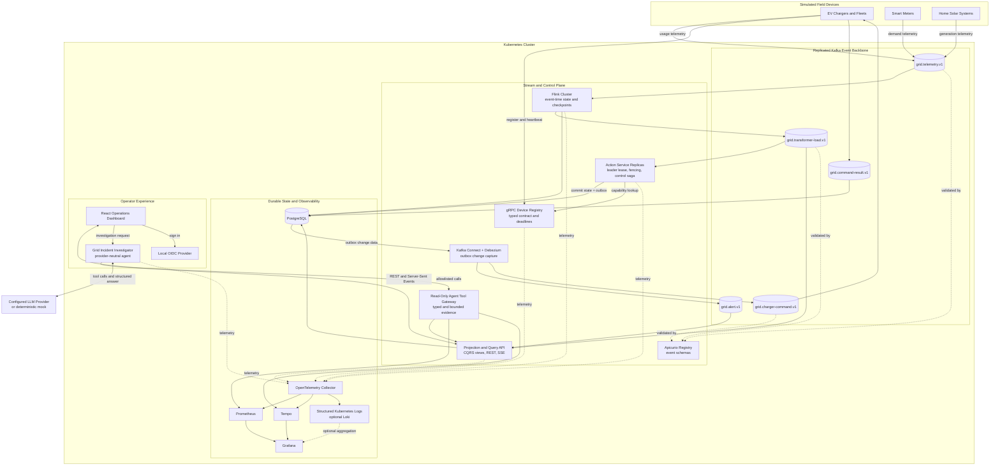
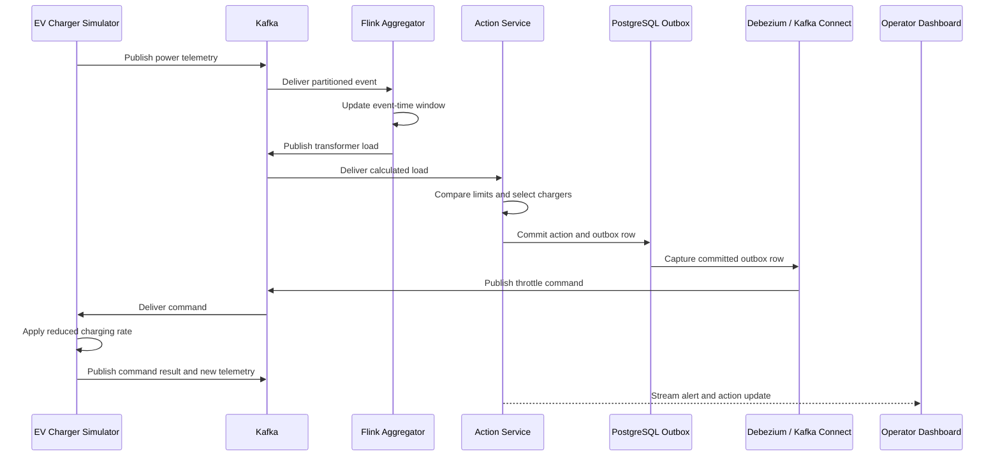
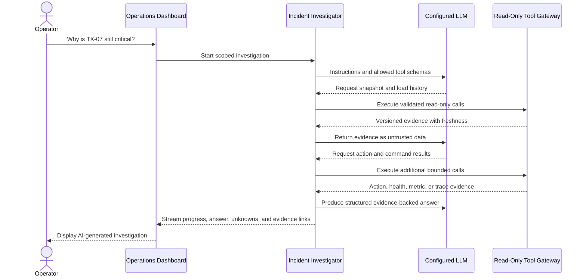

# Smart Grid / EV Fleet Energy Balancing Platform

> **Status:** Design complete; implementation has not started. This repository currently contains the approved system design, interface contracts, UI plan, team ownership, and acceptance plan for the CMPE 273 final project.

## Abstract

This project proposes a distributed platform for monitoring and balancing electricity usage across neighborhood transformers. Thousands of simulated EV chargers, smart meters, and residential solar systems will publish time-series telemetry containing their current power demand or generation. The platform will ingest these events through Apache Kafka, process them in event-time windows, and maintain a continuously updated view of the load assigned to each transformer.

When a transformer approaches or exceeds its safe operating limit, an action service will select flexible EV charging loads and publish throttling commands. Charger simulators will apply those commands, report their updated demand, and later return to their normal charging rate when the transformer has recovered. This closed feedback loop demonstrates both monitoring and automated control instead of stopping at alert generation.

The design focuses on the distributed-systems problems behind this workflow: partitioned event ingestion, out-of-order telemetry, stateful stream processing, recovery from service failures, and duplicate-safe control actions. Flink checkpoints provide exactly-once state updates inside the stream-processing pipeline. External commands use deterministic IDs and idempotent consumers so that an at-least-once delivery does not throttle a charger twice.

A read-only Grid Incident Investigator complements the deterministic platform. An operator can ask why a transformer is critical or why a control action is incomplete, and the agent gathers versioned grid state, action history, stream health, metrics, and trace summaries through allowlisted tools. Its response separates observations from hypotheses and links every important claim to evidence. It cannot calculate authoritative state, change policy, or publish charger commands.

## Business Value

EV adoption can increase neighborhood demand faster than utilities can replace transformers and distribution equipment. The highest demand often lasts for only a short period, such as the early evening when residents arrive home and begin charging. Coordinating flexible charging loads gives a utility another way to manage those peaks without immediately upgrading every transformer.

The platform will help an operator see where demand is building, identify the transformer at risk, and understand the corrective action taken by the system. For example, fleet vehicles that do not need to depart until the next morning can charge at a lower rate for several minutes while residential demand is high. Once the load returns below a recovery threshold, normal charging can resume automatically.

The project supports grid reliability, cleaner transportation, and better use of existing infrastructure. The evidence-grounded investigator adds operational value by reducing the time needed to assemble load, action, command, metric, and trace evidence without giving a probabilistic model control authority. Although the final demonstration will use synthetic devices and data, the event-driven architecture could later connect to real chargers and meters through utility or IoT gateways.

## MVP at a Glance

| Capability | MVP scope |
|---|---|
| Device simulation | Configurable EV charger, smart meter, and solar simulators assigned to multiple transformers |
| Telemetry ingestion | Kafka topics partitioned by `transformer_id` |
| Stream processing | Flink event-time windows, watermarks, checkpoints, and late-event handling |
| Grid state | Net transformer load, utilization percentage, health state, and recent trend |
| Automated response | Throttle and restore commands for eligible EV chargers |
| Persistence | CloudNativePG-managed PostgreSQL with persistent Kubernetes storage |
| Operator experience | React dashboard with live updates, charts, alerts, action history, and scenario controls |
| Kubernetes runtime | Multi-service deployment, discovery, health probes, reconciliation, scaling, and failure containment |
| Observability | OpenTelemetry logs/traces, Prometheus metrics, Grafana dashboards, SLIs, SLOs, and error budgets |
| Distributed coordination | Action-service leader lease and fencing epochs to reject stale workers |
| Durable workflows | Transactional outbox/inbox and a recoverable control saga |
| Failure demonstrations | Pod loss, broker loss, delayed/duplicate events, stale leader, and dependency latency |
| Agent-assisted operations | Evidence-grounded incident investigation using seven typed read-only tools and a deterministic fallback |

### Explicitly out of scope

The MVP will not connect to real utility equipment, control real vehicles, process customer billing, forecast market prices, provide multi-region disaster recovery, implement a custom consensus algorithm, run an autonomous control agent, or claim regulatory compliance. The incident investigator is deliberately read-only. Machine-learning forecasting, multi-agent swarms, mobile applications, service meshes, Consul, and production database failover are excluded. Kubernetes deployment is a core project requirement.

## Proposed Architecture Diagram



Telemetry is partitioned by `transformer_id`, keeping a transformer’s readings ordered within one Kafka partition while allowing different transformers to be processed in parallel. Solar generation is represented as negative demand. The aggregation job calculates net load over event-time windows and publishes a transformer-load event. The action service uses separate warning, critical, and recovery thresholds to avoid repeatedly throttling and restoring chargers when the load is close to a boundary.

Kubernetes is the target runtime. Services use stable cluster DNS, readiness/liveness/startup probes, resource limits, rolling updates, and multiple replicas where state ownership permits. The Action Service uses a Kubernetes Lease plus a monotonically increasing fencing epoch so a stale leader cannot issue a valid command. Docker Compose may remain as a lightweight developer profile, but the architecture review and final demonstration use Kubernetes.

The React dashboard is the primary project UI. Grafana is reserved for engineering evidence across metrics, traces, and structured logs. The Grid Incident Investigator is a required bounded extension, but it is isolated from the control path and integrated only after the deterministic telemetry-to-command loop and observability queries are stable. A deterministic mock provider keeps tests and the final demonstration independent of an external model API.

Detailed diagrams and rationale are available in the [system design](docs/design/SYSTEM_DESIGN.md), [data-flow design](docs/design/DATA_FLOW.md), [failure-handling design](docs/design/FAILURE_HANDLING.md), and [UI design](docs/design/UI_DESIGN.md).

## Build Versus Reuse

The team will build the parts that express the grid use case: device behavior, transformer aggregation, overload policy, fenced control workflow, projections, operator experience, and the bounded incident-investigation workflow. Mature open-source projects will provide the surrounding platform. Strimzi will operate Kafka, the Flink Kubernetes Operator will manage stream jobs, Debezium/Kafka Connect will publish transactional outbox records, Apicurio will govern event schemas, and CloudNativePG will manage the single required PostgreSQL instance. Keycloak, OpenTelemetry, Prometheus, Grafana, Tempo, k6, Toxiproxy, Testcontainers, official model SDKs, and schema-validation libraries cover identity, operations, testing, and model connectivity.

This still requires real distributed-systems work. The team owns partition and replication choices, event-time correctness, idempotency, fencing, failure recovery, security policy, SLOs, and measured failure experiments. It will not spend project time creating a broker, operator, schema registry, identity provider, telemetry collector, consensus algorithm, or generic test framework. The complete boundary and dependency criteria are in the [open-source reuse plan](docs/design/OPEN_SOURCE_STACK.md).

## Core Workflow



Additional workflow diagrams cover late telemetry, command deduplication, recovery, and UI updates in the linked design documents.

## Agentic Investigation Workflow



The model has no write-capable tool and the Copilot Service has no access to domain database tables, Kafka, shell, Kubernetes, or raw observability queries. Its application role can persist only bounded investigation/audit records. Provider failure returns a clear unavailable or partial result and never affects load balancing.

## Proposed Technology Used

| Layer | Proposed technology | Purpose |
|---|---|---|
| Simulators and services | Python 3.12 | Device behavior, scenarios, action logic, and supporting services |
| Messaging | Apache Kafka operated by Strimzi | Durable partitioned telemetry, derived events, commands, and Kubernetes-native lifecycle |
| Stream processing | Apache Flink/PyFlink with the Flink Kubernetes Operator | Event-time aggregation, watermarks, state, checkpoints, upgrades, and recovery |
| Schemas and CDC | Apicurio Registry, Kafka Connect, and Debezium | Schema compatibility and transactional outbox publication without custom infrastructure |
| Internal RPC | gRPC and Protocol Buffers | Typed device registration/capability contract with deadlines |
| Control API | FastAPI | CQRS projections, configuration, query APIs, health, and Server-Sent Events |
| Operational database | PostgreSQL managed by CloudNativePG | Durable control state, inbox/outbox, configuration, actions, and history |
| Web UI | React, TypeScript, Material UI, and Recharts | Simple, responsive, professional, and dynamic operator dashboard |
| Observability | OpenTelemetry Operator/Collector, Prometheus Operator, Grafana, Tempo, and structured Kubernetes logs | Correlated metrics, traces, logs, SLIs, SLOs, and incident evidence; Loki is optional |
| Target runtime | Kubernetes using kind or minikube, packaged with Helm and Kustomize | Service discovery, replica management, probes, scaling, and failure testing |
| Developer runtime | Docker Compose | Optional lightweight local profile; not the final deployment target |
| Identity and policy | OIDC/Keycloak, Kubernetes RBAC, NetworkPolicies, and Secrets | User and workload authorization with least privilege |
| Agent-assisted operations | Provider-neutral Copilot Service, typed function tools/MCP-compatible facade, and deterministic mock provider | Read-only incident investigation with evidence, auditability, and model portability |
| Testing | Pytest, Testcontainers, Playwright, k6, and Toxiproxy | Unit, integration, UI, load, latency, and deterministic fault testing |
| CI | GitHub Actions | Linting, contract validation, tests, and build verification |

Technology choices are proposals until the team closes the decisions listed in [docs/decisions/README.md](docs/decisions/README.md).

## Repository Organization

```text
CMPE-273-Group-10-Project/
├── README.md
├── CONTRIBUTING.md
├── docs/
│   ├── design/       # Architecture, data flow, failures, data, security, and UI
│   ├── contracts/    # Canonical event and HTTP interfaces
│   ├── course/       # Curriculum-to-feature traceability
│   ├── security/     # Threat model and security verification
│   ├── testing/      # Failure and load-test plans
│   ├── runbooks/     # Operational diagnosis and recovery
│   ├── team/         # Ownership, milestones, and individual work plans
│   ├── decisions/    # Open decisions and future ADRs
│   └── demo/         # Acceptance and final demonstration plan
├── schemas/          # Planned machine-readable event schemas
├── simulators/       # Planned EV, meter, solar, and scenario simulators
├── services/
│   ├── aggregation/  # Planned stream-processing component
│   ├── action/       # Planned threshold and control component
│   ├── registry/     # Planned internal gRPC device registry
│   ├── api/          # Planned operator-facing API and read-only tool gateway
│   └── copilot/      # Planned evidence-grounded incident investigator
├── dashboard/        # Planned React operator UI
├── infra/            # Planned Kubernetes, developer Compose, and observability assets
└── tests/            # Planned unit, integration, failure, load, and UI tests
```

All component directories currently contain design notes only. Their READMEs must be updated with verified setup commands when implementation begins.

## Team Ownership

| Team member | Distributed-systems workstream | Additional responsibility |
|---|---|---|
| Member_1 | Distributed device simulation, telemetry ingestion, and gRPC registry | Reliable producers/consumers, RPC deadlines, partition routing, and failure injection |
| Member_2 | Kafka platform and stateful Flink aggregation | Event-time correctness, checkpoints, replay, and transformer-load publication |
| Member_3 | Distributed action processing, coordination, and persistence | Leader leases, fencing, saga/outbox/inbox, durable state, and recovery |
| Member_4 | Kubernetes platform, real-time projections, and agent-assisted operations | Discovery, scaling, SSE recovery, Copilot/tool orchestration, OpenTelemetry, security integration, UI, and fault testing |

Ownership boundaries, milestones, and collaborative tests are defined in the [team overview](docs/team/TEAM_OVERVIEW.md).

## Proposed Acceptance Demonstration

The final demonstration will run in Kubernetes and show normal operation, overload control, leader failover with stale-command rejection, a pod or broker failure, checkpoint recovery, SSE reconnection, correlated metrics/logs/traces, and one evidence-grounded agent investigation. The control demonstration remains successful when the external model is disabled. The complete sequence and proposed measurements are in [docs/demo/ACCEPTANCE_PLAN.md](docs/demo/ACCEPTANCE_PLAN.md).

## Project Documentation

- [Documentation index](docs/README.md)
- [System design](docs/design/SYSTEM_DESIGN.md)
- [Data flow and stream semantics](docs/design/DATA_FLOW.md)
- [Data model](docs/design/DATA_MODEL.md)
- [Failure handling and recovery](docs/design/FAILURE_HANDLING.md)
- [UI/UX design](docs/design/UI_DESIGN.md)
- [Security and privacy design](docs/design/SECURITY_AND_PRIVACY.md)
- [Kubernetes deployment design](docs/design/KUBERNETES_DEPLOYMENT.md)
- [Communication and resilience](docs/design/COMMUNICATION_AND_RESILIENCE.md)
- [Transactions and control saga](docs/design/TRANSACTIONS_AND_SAGAS.md)
- [Coordination and fencing](docs/design/COORDINATION_AND_FENCING.md)
- [Replication and consistency](docs/design/REPLICATION_AND_CONSISTENCY.md)
- [Observability and SLOs](docs/design/OBSERVABILITY_AND_SLOS.md)
- [Project scope and delivery tiers](docs/design/PROJECT_SCOPE.md)
- [Open-source reuse and build boundary](docs/design/OPEN_SOURCE_STACK.md)
- [Evidence-grounded Grid Incident Investigator](docs/design/AGENTIC_COPILOT.md)
- [Event contracts](docs/contracts/EVENT_CONTRACTS.md)
- [HTTP API contracts](docs/contracts/API_CONTRACTS.md)
- [Agent tool and evidence contracts](docs/contracts/AGENT_TOOL_CONTRACTS.md)
- [gRPC registry contract](docs/contracts/GRPC_CONTRACTS.md)
- [Team work allocation](docs/team/TEAM_OVERVIEW.md)
- [Acceptance plan](docs/demo/ACCEPTANCE_PLAN.md)
- [Open decisions](docs/decisions/README.md)
- [Course alignment](docs/course/CURRICULUM_ALIGNMENT.md)
- [Threat model](docs/security/THREAT_MODEL.md)
- [Failure-injection matrix](docs/testing/FAILURE_INJECTION_MATRIX.md)
- [Load-test plan](docs/testing/LOAD_TEST_PLAN.md)
- [Agent evaluation plan](docs/testing/AGENT_EVALUATION_PLAN.md)
- [Incident runbook](docs/runbooks/INCIDENT_DIAGNOSIS.md)

## Security and Project Hygiene

No real customer, utility, location, or vehicle data will be used. Secrets, access tokens, private keys, database files, and generated telemetry must not be committed. Example configuration should contain safe placeholders only. The platform is an educational simulation and must never be connected to real charging or grid equipment without a separate safety and security review.
