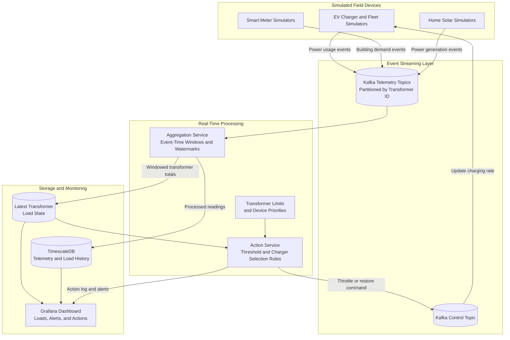

# Smart Grid / EV Fleet Energy Balancing Platform

## Abstract

The goal of this project is to build a distributed system that can monitor and balance electricity usage in a neighborhood with a large number of electric vehicles, smart meters, and home solar installations. As more people charge their vehicles at the same time, especially during evening peak hours, the total demand can rise quickly and place too much load on a local transformer. A utility company needs to recognize this situation early and respond before it causes a brownout or equipment failure.

Since we will not be connecting to real utility hardware, the project will include simulators for EV chargers, smart meters, and solar panels. These simulators will continuously generate telemetry events containing information such as the device ID, transformer ID, event timestamp, and current power usage or generation. Apache Kafka will receive these events and distribute them across partitions so that multiple consumers can process the data in parallel.

A stream-processing service will group the readings by transformer and calculate the current load over short time windows. If the calculated load crosses a configured safety limit, an action service will decide which chargers can be temporarily slowed down and publish a throttling command. The simulated chargers will consume those commands, adjust their power usage, and send updated readings back into the system. This creates a complete feedback loop instead of only displaying an alert.

The project will also focus on problems that are common in real distributed systems. Telemetry may arrive late or out of order, a service may restart while processing a message, and individual partitions may become temporarily unavailable. We will use event-time processing, checkpoints, and idempotent commands to keep the transformer totals accurate and avoid applying the same action more than once.

## Business Value

Electric vehicle adoption is increasing faster than many neighborhoods can upgrade their electrical infrastructure. Replacing transformers and power lines is expensive and takes time, but the highest demand may only occur for a few hours each day. A system that can coordinate flexible loads, such as EV charging, gives utilities another way to handle these short peaks without immediately replacing every transformer.

The platform can help an energy provider see where demand is building, identify which transformer is at risk, and take a limited corrective action. For example, several fleet vehicles that do not need to leave until the next morning could charge at a lower rate for 15 minutes while household demand is high. Once the load returns to a safe level, normal charging can resume. This is more useful than simply shutting chargers off because the response can be based on the urgency and power needs of each vehicle.

From a social perspective, better load balancing can reduce brownouts and support the transition to cleaner transportation. It can also help utilities make better use of residential solar generation and existing grid capacity. Although this project uses simulated data, the same design could later be connected to real chargers and meters through standard IoT gateways.

## Proposed Architecture Diagram

Each simulated device is assigned to a transformer. Telemetry is partitioned by `transformer_id`, which keeps readings for the same transformer together and allows different transformers to be processed in parallel. A typical event will contain the device ID, transformer ID, device type, event timestamp, and power value in kilowatts. Solar generation will be treated as negative demand when the service calculates the net load.

The aggregation service will use event-time windows rather than the time at which a message reaches the server. Watermarks will allow the service to wait briefly for late readings before finalizing a window. The calculated load will be saved for historical analysis and sent to the action service. If a threshold is crossed, the action service will choose eligible chargers based on rules such as current charging rate, required departure time, and device priority.

Control messages will travel through a separate Kafka topic. Every command will have a unique ID so that a charger can safely ignore a duplicate message. After changing its charging rate, the charger simulator will continue reporting its usage. Those new readings allow the platform to confirm that the action reduced the transformer load and to restore normal charging when conditions improve.

## Proposed Technology Used

- **Python:** Python will be used to build the device simulators and supporting services. It will allow us to generate different usage patterns, including normal demand, sudden charging spikes, delayed events, and temporary device failures.
- **Apache Kafka:** Kafka will act as the main messaging layer. Separate topics will be used for telemetry and control commands, and telemetry will be partitioned by transformer ID to support parallel processing.
- **Apache Flink:** Flink will perform the real-time aggregations. Its event-time windows, watermarks, state management, and checkpoints are useful for handling late data and testing exactly-once processing behavior.
- **FastAPI:** FastAPI will provide endpoints for registering simulated devices, configuring transformer thresholds, viewing the current system state, and manually starting test scenarios.
- **PostgreSQL with TimescaleDB:** TimescaleDB will store raw or processed telemetry, transformer load history, alerts, and actions. This data will be useful for queries and dashboard charts without placing that workload on the streaming pipeline.
- **Grafana and Prometheus:** Grafana will display transformer load, active chargers, alerts, processing delay, and throttling actions. Prometheus will collect health and performance metrics from the services.
- **Docker Compose:** The simulators, Kafka, Flink, APIs, database, and monitoring tools will run as separate containers. Docker Compose will make it possible for every team member to start the same multi-service environment locally.

