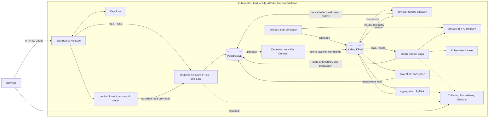
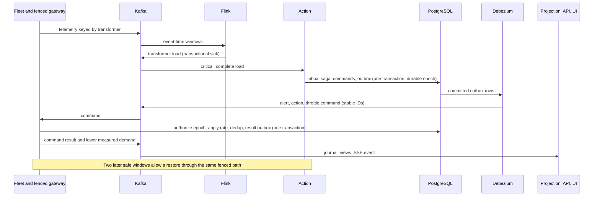

# GridBalance master guide

Smart Grid / EV Fleet Energy Balancing Platform. This is the one document to read before a demo and to defend the design afterwards. It covers the problem, the architecture, the data flow, every design decision, how to run and operate the hosted deployment, the demo script and the honest limits. Detail that does not fit here lives in the linked [contracts](#14-where-the-details-live), [ADRs](decisions/README.md) and component READMEs.

## 1. Demo cheat sheet

| Item | Value |
|---|---|
| Live site | <https://smart-grid-ev-review-9e9.denmarkeast.cloudapp.azure.com/> (no login) |
| Control room | `/` and `/live` |
| Full operator console | `/operator` (Overview, Flow Map, Transformers, Alerts & actions, Devices, Scenarios, System health, Settings) |
| Grafana (read only) | `/grafana/d/grid-control-room`, `grid-pipeline`, `grid-kafka`, `grid-platform`, `grid-storage` |
| Health | `/readyz`, `/healthz` |
| Review window ends | Tue 2026-12-01 12:32:55 PM PST. The demo is Mon 2026-11-30. |
| Pre-demo check | `.venv/bin/python -m tools.demo_check` (read only, exits 1 on a failure) |
| Kubeconfig | `export KUBECONFIG=.tools/aks-review/kubeconfig` (context `smart-grid-aks-review`, namespace `platform`) |

**Thirty-second pitch.** A neighborhood transformer overloads when many EVs charge at once. The platform ingests readings from 1,000 simulated devices on 25 transformers, aggregates them per transformer in event time with PyFlink, and decides when to act. Action writes a throttle plan and its outbox rows in one PostgreSQL transaction. Debezium publishes the commands. A fenced simulated gateway applies them exactly once, the measured EV demand drops, and charging is restored when the load is safe. Everything is observable, replayable and runs on Kubernetes.

**What to show, in order** (full script in [section 10](#10-demo-script-10-minutes)): the control room KPI strip and heat map; an overload on a hero transformer going through plan, throttle, confirmed reduction and restore; the fault buttons (out of order, duplicates, very late) moving the correctness counters without changing results; a TaskManager kill with recovery in about 30 s; the Grafana pipeline, Kafka and storage dashboards; the limits slide.

**Do not on demo day:** roll out images, restart Action, PostgreSQL or Kafka, or change the fleet size. If the fleet looks idle, restart only `deployment/fleet`. After the freeze (Sun 2026-11-29 18:00) only a rollback to a recorded digest is allowed.

## 2. What the system does

**Problem.** EV charging, smart meters and rooftop solar change a transformer's net load every few seconds. A utility wants to reduce charging demand before the transformer overloads, without double-applying a command, losing a command, or acting on stale data.

**Outcome.** For each transformer the platform computes net load and utilization per five-second event-time window, classifies it (`NORMAL`, `WARNING`, `CRITICAL`, `STALE`), and runs a recoverable control saga for critical transformers. Operators see live state, history, alerts and actions, and can ask a bounded read-only investigator to explain an incident with cited evidence.

**Scope.** Synthetic devices and simulated chargers only. No real utility equipment, customer data or external model calls (the Investigator uses a deterministic mock). The required target is local kind on Docker Desktop. The same manifests run on one AKS review cluster for the hosted demo.

**Functional requirements.** FR-01 simulate EV chargers, meters and solar. FR-02 publish versioned telemetry with device and ingestion time. FR-03 partition and process by transformer. FR-04 compute demand, solar, EV demand, net load and utilization per window. FR-05 classify grid state. FR-06 select eligible chargers and issue throttle and restore commands. FR-07 track delivery and acknowledgement. FR-08 store load history, alerts and actions. FR-09 live browser UI. FR-10 demonstrate late data, duplicates, restart recovery and degraded components. FR-11 Kubernetes probes, discovery and resource policy. FR-12 leader election and fencing. FR-13 correlate an action across HTTP, gRPC, Kafka, Flink, SQL and the UI. FR-14 bounded read-only investigation with evidence.

## 3. Architecture



| Component | Package | Role | Workload on AKS | State |
|---|---|---|---|---|
| Fleet simulator | `devices/fleet.py` | 25 transformers x 40 devices (55% meters, 35% EV chargers, 10% solar), one reading per device every 5 s (200 events/s), rotating incidents on five hero transformers, fault injection through a token-protected control port | `Deployment/fleet` | Fenced edge state in PostgreSQL |
| Registry | `devices/registry.py` | gRPC device registry with deadlines, idempotent operations, capability versions | `Deployment/registry` | `local_dev_registry` |
| Fenced gateway | `devices/fencing.py` | Applies a command only if its epoch is current, in the same SQL transaction as the effect, the dedup record and the result outbox | inside `fleet` | `integration_edge` schema |
| Aggregation | `aggregation/` | PyFlink job keyed by transformer: validate, dedup, window, checkpoint, publish load, DLQ and late audit | `FlinkDeployment/aggregation` (JobManager and one TaskManager on the Flink node) | Checkpoint PVC |
| Action | `action/` | Leader-elected control saga: policy, charger selection, inbox and outbox, compensation | `Deployment/action` | `local_dev_control` |
| Debezium | `action/cdc.py`, `infra/connect/` | Captures committed outbox rows and publishes alerts, actions and commands | `KafkaConnect/grid-connect` | Replication slot |
| Projection and API | `projection/` | Idempotent read model, REST, SSE with cursors, role checks, scenario and policy contract mocks | `Deployment/projection`, `Deployment/api` | `local_dev_projection` |
| Dashboard | `dashboard/` | NiceGUI control room and operator console | `Deployment/ui` | None (ring buffer in memory) |
| Identity | `identity/` | Keycloak realm, OIDC, roles Viewer, Operator, Administrator | `Deployment/keycloak` (scaled to 0 on the review cluster) | `local_dev_keycloak` |
| Investigator | `copilot/` | Read-only typed tools, citations, audit, deterministic mock provider | `Deployment/copilot` (scaled to 0 on the review cluster) | SQLite PVC |
| Observability | `observability/`, `infra/observability/` | OpenTelemetry Collector, Prometheus, Grafana dashboards generated in code | `observability` namespace | 24 h metrics |
| Contracts | `schemas/v1/` | JSON Schema, OpenAPI, Protobuf, golden cases, compatibility gate | none | Git |

**Hosted deployment (AKS).** Resource group `rg-smart-grid-professor-review`, cluster `smart-grid-aks-review` in Denmark East, registry `smartgridevreview9e9`. One `Standard_DS3_v2` system node and one `Standard_D2_v2` node labelled `grid-role=flink`: 6 of 6 regional vCPUs of the Azure for Students quota, spending limit on. Azure CNI Overlay with Cilium, `grid-ssd` Standard SSD volumes, Caddy terminating HTTPS in front of the UI. Namespaces: `platform` (workloads, PostgreSQL, Kafka, Connect, Flink), `grid-operators` (Strimzi, Flink operator), `observability`. Only the edge has a public address. Full runbook: [infra/aks/AGENT_RUNBOOK.md](../infra/aks/AGENT_RUNBOOK.md).

**Local deployment (kind).** One Docker Desktop node with Calico (NetworkPolicy enforcement). Dev profile has one Kafka broker. The review profile has three KRaft brokers with replication factor 3 and `min.insync.replicas=2`. See [infra/kind](../infra/kind/README.md).

## 4. Data flow end to end



### Topics

Physical names carry a prefix (`integration-kind.` on kind and AKS). Three partitions each. One broker and replication factor 1 on AKS.

| Topic | Key | Producer | Consumers |
|---|---|---|---|
| `grid.telemetry.v1` | `transformer_id` | Fleet | Flink |
| `grid.transformer-load.v1` | `transformer_id` | Flink | Action, projection |
| `grid.alert.v1`, `grid.action.v1` | `transformer_id` | Debezium from the Action outbox | Projection |
| `grid.charger-command.v1` | `device_id` | Debezium from the Action outbox | Fleet gateway |
| `grid.command-result.v1` | `device_id` | Gateway | Action, projection |
| `grid.telemetry.dlq.v1`, `grid.telemetry.late.v1` | original key | Flink | Audit, projection |

Retention on AKS is a rolling three hours with per-partition size caps and small 8 MiB segments that roll every ten minutes (Kafka deletes only closed segments), so old records are deleted before a volume fills. The projection keeps a 30-minute window of device readings and prunes the rest. Field definitions are in [event contracts](contracts/EVENT_CONTRACTS.md).

### Windows and load

- Five-second half-open tumbling event-time windows. The window takes the latest accepted reading per device.
- Watermark delay 10 s. A reading with `ingested_at` up to 30 s after the window end corrects the emitted window (new revision, same window ID). Later readings go to `grid.telemetry.late.v1` and never rewrite control history.
- Duplicate `event_id`s are ignored and counted. Identity is remembered 120 s behind the watermark, so state stays bounded at 200 events/s ([ADR-037](decisions/ADR-037-continuous-fleet-and-rolling-retention.md)).
- A window is `COMPLETE` when at least 95% of expected devices have `GOOD` readings, `PARTIAL` from 70%, and `STALE` below 70% or when the load result is older than 15 s. Automatic control needs a fresh `COMPLETE` window.
- Power is in kW, consumption positive, generation negative.

```text
net_load_kw     = meter_demand_kw + ev_demand_kw - solar_generation_kw
utilization_pct = net_load_kw / transformer_capacity_kw * 100
```

Rules in full: [Stream semantics v1](contracts/STREAM_SEMANTICS_V1.md).

### Control policy and saga

- Warning at 80% utilization, critical at 95%, recovery at or below 75% for two consecutive fresh `COMPLETE` windows (hysteresis). A cooldown blocks a new plan until the last one could take effect.
- Eligible chargers are online, charging, controllable, above their minimum rate (1.0 kW, maximum 7.2 kW) and not near departure. Less urgent sessions are reduced first. A plan records the triggering load revision, policy version, candidates, selected devices and expected reduction.
- Saga states: `PLAN_CREATED`, `COMMANDS_DISPATCHED`, `ACKS_PENDING`, `REDUCTION_CONFIRMED`, `RECOVERY_MONITORING`, `RESTORE_DISPATCHED`, `COMPLETED`, with `PARTIALLY_APPLIED`, `TIMED_OUT` and `NEEDS_OPERATOR_REVIEW` as the failure states.
- Invariants: one active saga per transformer; one logical command per action, device and type; no command from a stale epoch; a timeout is an unknown outcome until reconciled; restore needs authoritative fresh state, and missing telemetry never implies recovery.
- A plan held for review is retried with approved compensation (`ACTION_AUTO_COMPENSATE=1`, at most three attempts). Real equipment would need an explicit approval policy instead.

## 5. Design decisions and where they show up

| Concern | Decision | Why | Where |
|---|---|---|---|
| Messaging | Kafka with per-transformer keys. Ordering holds within a partition, so everything for one transformer is ordered. | Durable, replayable, independent consumers | [ADR-024](decisions/ADR-024-pinned-local-baseline.md), topics above |
| Stream processing | PyFlink, keyed by transformer, bounded per-window state, checkpoints every 2 s, transactional Kafka sink | Event time, late data and recovery are part of the problem. All application code stays Python. | [ADR-002](decisions/ADR-002-python-stream-processing.md), [ADR-027](decisions/ADR-027-standalone-aggregation.md), [aggregation](../aggregation/README.md) |
| Time and ordering | Event time, watermarks, window revisions, saga versions, fencing epochs. Wall clocks do not establish causality. | Late and out-of-order data are normal | [Stream semantics](contracts/STREAM_SEMANTICS_V1.md) |
| Distributed transaction | Transactional outbox plus Debezium instead of a custom relay. Each state-changing consumer has an inbox keyed by event ID. Repeat delivery is expected and safe. | A crash between "save plan" and "publish command" must lose and repeat nothing | [ADR-029](decisions/ADR-029-outbox-and-fencing.md), [ADR-028](decisions/ADR-028-action-domain.md) |
| Leader election and fencing | A Kubernetes Lease picks the Action leader. PostgreSQL allocates a monotonic fencing epoch. The gateway checks the epoch in the same transaction as its effect. | A paused old leader can wake up after its lease expired. A device-only "greatest epoch seen" check cannot reject an old command that arrives first. | [ADR-029](decisions/ADR-029-outbox-and-fencing.md), [action](../action/README.md) |
| Consistency | Control writes choose consistency over availability: one PostgreSQL primary, optimistic versions, fail rather than create two plans. History reads may be stale but are labelled. | A wrong control decision costs more than an unavailable page | [data model](#6-data-and-ownership) |
| Idempotent effects | Deterministic command IDs and a device-side processed-command ledger. Acknowledging a Kafka record is not proof a charger changed. The result event is. | At-least-once delivery cannot be exactly-once without an idempotent effect | `devices/fencing.py` |
| Read model | CQRS: the projection consumes events into its own store with unique event IDs and upserts, and serves REST plus SSE with cursors. After a disconnect the client reloads the snapshot. | Rebuildable view, tolerant of replay | [ADR-030](decisions/ADR-030-projections-api.md) |
| Communication | REST and SSE to browsers, gRPC for the Registry, Kafka for the workflow. Every synchronous call has an end-to-end deadline, one layer retries, attempts are bounded with jittered backoff. | Typed contracts and explicit deadlines at each boundary | [contracts](contracts/API_CONTRACTS.md), [gRPC](contracts/GRPC_CONTRACTS.md) |
| Degradation | Prefer a visible degraded state over an unsafe decision. Stale data suspends new automatic plans and keeps already applied limits. | Safety | [failure matrix](#8-failure-handling-and-fault-drills) |
| Discovery | Kubernetes Services and DNS. Readiness drives routing, liveness only covers unrecoverable process failure. No Consul. | Overlapping membership problem | [kind runbook](../infra/kind/README.md) |
| Security | OIDC with PKCE, RS256 and JWKS, server-held tokens, opaque HttpOnly sessions, server-side role checks, ServiceAccount RBAC, default-deny NetworkPolicy, non-root read-only containers, Secrets outside Git | Defence in depth | [ADR-032](decisions/ADR-032-local-identity.md) |
| Observability | OpenTelemetry traces and metrics to a Collector, Prometheus, Grafana, JSON logs. W3C trace context over HTTP and gRPC. Kafka headers carry `traceparent`, `correlation_id` and `causation_id`. | Explain one grid outcome across every hop | [ADR-035](decisions/ADR-035-local-observability.md) |
| Agent | Bounded read-only tools, typed schemas, evidence IDs checked against returned results, no write path, deterministic mock model, audit | A model must not control the grid | [ADR-036](decisions/ADR-036-grid-incident-investigator.md) |
| Contracts | Frozen v1 JSON Schema, OpenAPI and Protobuf with a compatibility gate. A breaking change needs a new major version. | Independent components agree on wire shapes | [ADR-025](decisions/ADR-025-executable-contract-freeze.md), `make contracts` |
| Deployment | Kind locally, AKS for the demo, images by digest, pinned versions, no floating tags | Reproducible and rollbackable | [VERSION_MATRIX](implementation/VERSION_MATRIX.md), [ADR-034](decisions/ADR-034-local-kind-deployment.md) |

Course concepts this maps to: partial failure, REST and gRPC, messaging, time and ordering, coordination, replication and consistency, distributed transactions, fault tolerance, cloud-native runtime, observability, security and agentic systems. Each row above names where the evidence is.

## 6. Data and ownership

Each service owns its store. One PostgreSQL primary is shared only to fit student hardware. Services do not share tables or credentials. The gateway's narrow isolated schema in the control database is the one deliberate exception ([ADR-029](decisions/ADR-029-outbox-and-fencing.md)).

| Store | Owner | Contents | Rebuildable |
|---|---|---|---|
| `local_dev_registry` | Registry | Devices, assignments, capabilities, heartbeat, idempotent operations | From re-registration |
| `local_dev_control` | Action | Policies, action plans, commands, inbox, outbox, fencing epochs, CDC heartbeat. Schema `integration_kind` | No. Authoritative, needs backup |
| `integration_edge` schema | Gateway | Simulated charger rate, epoch, effect count, processed commands, result outbox | No (simulated effects) |
| `local_dev_projection` | Projection | Event journal, load history, alert and action views, SSE cursors, source positions | From Kafka inside retention |
| `local_dev_keycloak` | Keycloak | Realm, users, sessions | From the realm import |
| Investigator SQLite | Copilot | Investigations, tool calls, evidence references | Non-authoritative |

Aggregation writes no PostgreSQL data. Flink publishes to Kafka and the projection persists history.

## 7. The hosted demo environment

**Fleet.** 25 transformers (`tx-001` to `tx-025`) x 40 devices = 1,000 devices, 200 events/s. Transformers `tx-001` to `tx-005` are hero transformers: 70 registered chargers whose rate follows the real Action commands. Each hero runs a 240 s cycle with a 90 s overload, staggered by 48 s per hero, so an incident is usually in progress somewhere. The other 20 transformers send telemetry, are aggregated and show up in the control room and Grafana, but receive no commands. Background noise: about 1% late, 1% duplicate and 0.3% dropped readings, so the quality flags are never empty.

**Why not more.** Flink handled about 1,100 records/s on its node. The practical ceiling for the 5-second reporting rule is about 700 events/s. A 75 x 40 fleet (600 events/s) ran at about 50% Flink busy and was reverted because the Flink node memory is tight (87%) and the cluster has no vCPU left to add a node.

**Measured on AKS** (details in [implementation status](implementation/IMPLEMENTATION_STATUS.md)):

| Measurement | Result |
|---|---|
| Steady load | 200 events/s in, Flink busy about 20-25%, consumer lag under 500, checkpoint median about 120 ms, state about 3.4 MiB and flat |
| Window to Kafka | 10.4 to 12.6 s (10 s watermark delay plus about 1 s) |
| Backlog drain | 108,496 records behind, drained in 93 s after a 110 s restart, about 1,100 records/s net of live input. 100k records drain in under 5 minutes. This is not a 1M-in-5-minutes claim. |
| Closed loop | Each hero cycles overload, plan, throttle, confirmed reduction (about 35 kW per transformer), recovery and restore to `COMPLETED` about every four minutes. About 12 actions complete in 10 minutes across the fleet. |
| TaskManager kill | Job `RUNNING` again in 33 s, output fresh about 12 s later, no restart of Action, projection or fleet, lag 529 to 115 |
| Duplicate burst (60 s) | Duplicates dropped per minute 118 to 3,048, results unchanged |
| Out-of-order burst (60 s) | Window corrections per minute 58 to 1,082, results converge |
| Storage after one hour | PostgreSQL 14%, Kafka 5% of 8 GiB, checkpoints 5%, WAL 128 MB, replication slot lag 4 MB |

**Control room** (`/live`): KPI strip (fleet demand, fleet utilization, EV charging, solar generation, transformers at risk, automatic actions, events per second, output freshness), a flow strip from devices to actions, fleet load and capacity chart, 5 x 5 transformer heat map, most loaded transformers, live action feed, pipeline throughput, consumer lag, Flink busy time and backpressure, correctness counters (duplicates dropped, late, corrections, DLQ), retention and storage gauges, and the fault and incident panel.

**Grafana** (anonymous Viewer, provisioned from `observability/demo_dashboards.py`): `grid-control-room`, `grid-pipeline`, `grid-kafka`, `grid-platform`, `grid-storage`.

## 8. Failure handling and fault drills

| Failure | Detection | Behavior | What the operator sees |
|---|---|---|---|
| Malformed telemetry | Schema validation | DLQ, healthy records continue | DLQ count |
| Late telemetry | Ingestion time against window end + 30 s | Correct the window or audit only | Corrections or very-late counter |
| Duplicate telemetry | Event ID in window state | Ignored | Duplicates dropped |
| Flink task failure | Job status, checkpoints | Restart from the last checkpoint, committed output | Job restarting, lag |
| Kafka unavailable | Client errors | Backoff and retry, data goes stale | Stale badge, freshness |
| Action restart | Lease, durable epoch, consumer offsets | New leader, old active plans enter review, commands deduplicated | Held plans retried |
| Stale leader | Epoch check in the gateway transaction | Delayed command rejected | Fencing rejection |
| Command result missing | Deadline | Retry within policy, then review. Never a second device effect. | Partial or timed-out action |
| Database unavailable | Health check | Streams continue where possible, projections retry, writes stop | History unavailable, state partial |
| API or SSE disconnect | Heartbeat | Reconnect with the last cursor, then reload the snapshot | Reconnecting badge |
| Pod loss | Readiness, endpoints | Kubernetes reconciles | Restart count |
| Model provider outage | Deadline, breaker | Agent degrades, control loop unaffected | Investigator unavailable |
| Prompt injection or write-tool request | Allowlist and schema | Denied and audited | Denial in audit |

**Stale data policy.** Automatic actions need a fresh, complete-enough window. When data is stale the system keeps already applied limits, suspends new automatic plans and alerts. It does not restore charging merely because telemetry disappeared.

**Live drills** (from the control room, or `tools.demo_check` to verify afterwards):

1. Out of order, Duplicates or Very late for 30 s. Counters on the left move within seconds. Load totals do not change.
2. Trigger overload on `tx-001` to `tx-005` for 90 s. Watch the feed.
3. Kill the TaskManager (keep a terminal ready):
   `kubectl -n platform delete pod -l component=taskmanager,grid-app=aggregation`.
   Expect the job `RUNNING` again in about 30 s with no change in Action, projection or fleet.

Do not run drills that restart Action, PostgreSQL or Kafka during the demo.

## 9. Operations

### Before the demo

```bash
export KUBECONFIG=.tools/aks-review/kubeconfig
.venv/bin/python -m tools.demo_check
```

Checks the public endpoints, Flink, Debezium connector and task, replication slot lag and WAL size, volumes, pod restarts, the action cycle and plans held for review. Everything should be `PASS`. Also confirm the Azure subscription spending limit is on (runbook section 1).

### Rollout and rollback (by image digest)

```bash
az acr login -n smartgridevreview9e9
infra/aks/build-layer.sh <fleet|aggregation|action|ui|api|registry> <tag>   # builds, pushes, records the digest
.venv/bin/python -m tools.aks_demo render Deployment/ui             # inspect what will be applied
.venv/bin/python -m tools.aks_demo apply Deployment/ui              # scoped apply by digest
.venv/bin/python -m tools.demo_check
```

Previous digests are kept in `.tools/aks-demo/*-previous-image.txt`. Roll back with `kubectl set image`. A Flink spec change restarts the job statelessly. Open windows are re-emitted and Action keeps the first copy. Authorization, spending limit and budget checks come first: see [AGENTS.md](../AGENTS.md) and the runbook.

### Incidents seen on the live cluster, and the fixes

| Incident | Cause | Fix |
|---|---|---|
| Kafka broker hung, projection crash-looped, Flink restart loop | Broker heap `-Xmx384m` hit `OutOfMemoryError` and the JVM did not exit | Heap 768m, memory limit 1536Mi, `-XX:+ExitOnOutOfMemoryError` so Kubernetes restarts it |
| Projection `checkpoint outside Kafka retention` after the outage | Stored offset older than the three-hour window | In rolling mode resume at the oldest retained offset and log `projection_checkpoint_expired`. Full-history mode still fails loudly. |
| Debezium task failed, no alerts or commands | Replication slot `wal_status=lost` during the outage (`max_slot_wal_keep_size` 768 MB) | Drop the slot (`pg_drop_replication_slot`), restart the connector task |
| Four plans stuck in `NEEDS_OPERATOR_REVIEW`, 15 chargers throttled | Three compensation attempts used up while Debezium was down | Close the plans (status `COMPLETED`, `active=false`, `version+1` in both the column and the JSON), set the chargers back to 7.2 kW. Do not reset `compensations` to 0: it re-issues attempt IDs and crashes Action on a duplicate key. |
| Action crash-looped on one malformed reading | One non-UUID telemetry record | Action skips malformed readings, re-emitted load revisions and duplicate results |
| Debezium slot held 600 MB of WAL | Only one table is published | Heartbeat row in the same database advances the slot |
| Grafana panels timed out | A network policy let only the UI reach Prometheus | Policy allows Grafana |

Open item: `tools.demo_check` reports the slot's lag and WAL size but not its `wal_status`.

### Local recovery

PostgreSQL export and restore drill: `tools.delivery_backup export|restore-drill`. Rebuild the projection views in place: `kubectl exec deploy/projection -- /opt/venv/bin/python -m projection rebuild` (takes the store lock, keeps the journal and source positions, rotates the SSE generation). Flink recovery from a TaskManager kill uses the checkpoint on the PVC. Step by step: [recovery drills](../infra/kind/README.md#recovery-drills).

### Diagnosing an incident

1. State the symptom and an absolute time window. Compare an equal baseline window.
2. Check freshness, Kafka lag, checkpoint age, ready replicas and the SLIs in Grafana.
3. Open a trace for the slow or failing boundary, then follow the trace and correlation IDs into JSON logs and action history.
4. Optionally run the Investigator for candidate evidence. Verify every observation against its linked evidence.
5. Record one observation, one hypothesis, one alternative and one missing signal. Choose a bounded mitigation with rollback criteria. Never blindly retry an uncertain effect.
6. Verify recovery with the business outcome, technical metrics and a fresh trace.

Missing data is not zero, correlation is not causation, a timeout is not a failed write, and a pod restart is not application recovery.

## 10. Demo script (10 minutes)

| Min | Say | Do |
|---|---|---|
| 0-1 | The problem and the value. 1,000 devices, 25 transformers, live. | Open `/`. Point at the KPI strip, freshness badge and heat map. |
| 1-2.5 | Ingest and partitioning. Three partitions keyed by transformer, lag near zero. | Scroll to pipeline throughput and consumer lag. Open Grafana `grid-pipeline` in a second tab. |
| 2.5-5 | The hard parts of streaming: out-of-order, duplicates, late data. Results do not change. | Click Out of order, then Duplicates. Show the correctness counters move and the load chart stay put. |
| 5-7.5 | The control loop. Atomic plan and outbox, Debezium, fenced gateway, measured reduction, restore. | Pick an incident on `tx-003`, Trigger overload. Follow the live action feed from plan to throttle to confirmed reduction to restore. Open `/operator`, Alerts & actions, the completed action and Investigate for the cited mock explanation. |
| 7.5-8.5 | Fault tolerance. | Delete the TaskManager. Show the job back to `RUNNING` in about 30 s with Action unchanged. |
| 8.5-9.5 | Observability and rolling retention. | Grafana `grid-platform` and `grid-storage`: volumes, oldest retained data, the three-hour window. |
| 9.5-10 | Limits and next steps. | Section 11. |

**Likely questions.**

- *Is it exactly-once?* Flink with transactional sinks gives exactly-once Kafka visibility. The charger effect is made idempotent with deterministic command IDs and a processed-command ledger. We do not claim platform-wide exactly-once.
- *What if Debezium or Kafka is down?* The outbox rows stay committed in PostgreSQL and are published when the connector returns. Repeat publication is safe because consumers deduplicate by event ID. We hit this on the live cluster, and the table in section 9 lists what failed and what changed.
- *What if the Action leader pauses?* A new pod takes the Lease and a higher epoch. The old leader's delayed command is rejected inside the gateway's transaction.
- *Why one broker on AKS?* The student quota is 6 vCPUs. Replication factor 3 with `min.insync.replicas=2` is demonstrated on the local three-broker profile, not claimed on AKS.
- *Why 25 transformers and 200 events/s?* Each 5-second window needs at least 70% of its devices to avoid the `STALE` flag, so devices cannot report slower than every 5 s. 200 events/s leaves several times headroom. The measured ceiling is about 700 events/s.
- *Why keep only three hours?* Kafka holds 8 GiB. Three hours of telemetry at 200 events/s fits uncompressed, and the size caps stop a full disk. Older evidence lives in the status document.

**If something breaks.** Restart only `deployment/fleet` if the fleet is idle. Fall back to the backup video and screenshots (record two clean runs on Sunday, before the freeze). Do not roll out new images.

## 11. Limits and honest claims

- Single Kafka broker with replication factor 1 on AKS. The three-broker evidence is local only.
- Single PostgreSQL primary, no replicas. A single-node Kubernetes cluster does not prove host or zone availability.
- Flink runs on one small node. The projection and API cover the five managed (hero) transformers. The other 20 appear through Prometheus.
- A stateless Flink restart re-emits revisions for open windows. Action keeps the first copy.
- Compensation restores simulated chargers automatically. Real equipment needs an approval policy.
- Simulated devices, mock Investigator, no real utility integration. Control uses deterministic rules, not an optimal power-flow model.
- Latency targets (for example 99% of critical decisions within 2 s) are proposals until measured on a named environment. Measured values are in section 7.

## 12. Run it locally

Prerequisites: Docker Desktop on Apple Silicon (8 CPUs, 10 GiB, built-in Kubernetes off), Python 3.12.9, kind 0.30.0, kubectl 1.34.0, Helm 3.19.0 ([LOCAL_PREREQUISITES](implementation/LOCAL_PREREQUISITES.md)). All Python work uses `.venv` or a component venv under `.tools`.

```sh
export KIND_NAME=smart-grid-kind-dev-demo01
make kind-create && make kind-install && make kind-deploy
make local-acceptance          # one-shot overload, throttle, restore, replay, recovery
make kind-open-ui              # http://127.0.0.1:18086
make kind-stop                 # keeps volumes
make kind-reset CONFIRM="$KIND_NAME"   # deletes the cluster and PVCs
```

Component work without a cluster: `make infra-up` starts disposable Kafka and PostgreSQL, then the targets in [tests/README.md](../tests/README.md). `make dashboard-demo` runs the console on a fixture API.

## 13. Repository map

```text
devices/        simulator, fleet, Registry, fenced gateway, images
aggregation/    PyFlink job, windowing, keyed bounded state
action/         control policy, saga, outbox, Lease, Debezium config
projection/     consumer, store, REST and SSE API, contract mocks
dashboard/      NiceGUI control room and console
identity/       Keycloak realm, OIDC helpers
copilot/        read-only Investigator
observability/  telemetry helpers, Grafana dashboards in code
schemas/        v1 contracts (generated bundle, never edited by hand)
infra/          kind, AKS, compose, observability, Connect
tools/          kind, delivery, AKS rollout, load and check scripts
tests/          one folder per component, plus contracts and tooling
docs/           this guide, contracts, ADRs, version matrix, status
```

Boundaries: `devices`, `aggregation`, `action` and `projection` do not import each other. They share only `schemas/v1` and fixtures. `make contracts` validates contracts, and `make bindings` generates the Registry bindings.

## 14. Where the details live

| Need | Document |
|---|---|
| Exact event, API, gRPC and agent-tool shapes | [contracts](contracts/EVENT_CONTRACTS.md), [API](contracts/API_CONTRACTS.md), [gRPC](contracts/GRPC_CONTRACTS.md), [agent tools](contracts/AGENT_TOOL_CONTRACTS.md), [stream semantics](contracts/STREAM_SEMANTICS_V1.md) |
| Why each choice was made | [Decision register](decisions/README.md) |
| What ran, when, with what result | [Implementation status](implementation/IMPLEMENTATION_STATUS.md) |
| Pinned versions | [Version matrix](implementation/VERSION_MATRIX.md) |
| Machine setup | [Local prerequisites](implementation/LOCAL_PREREQUISITES.md) |
| Measured local load | [Load test report](testing/LOAD_TEST_REPORT.md) |
| AKS rollout, quota and rollback | [AKS runbook](../infra/aks/AGENT_RUNBOOK.md), [AKS README](../infra/aks/README.md) |
| kind profiles and recovery | [kind README](../infra/kind/README.md) |
| Component runbooks | [devices](../devices/README.md), [aggregation](../aggregation/README.md), [action](../action/README.md), [projection](../projection/README.md), [dashboard](../dashboard/README.md), [identity](../identity/README.md), [Investigator](../copilot/README.md), [observability](../infra/observability/README.md) |
| Tests | [tests/README.md](../tests/README.md) |
