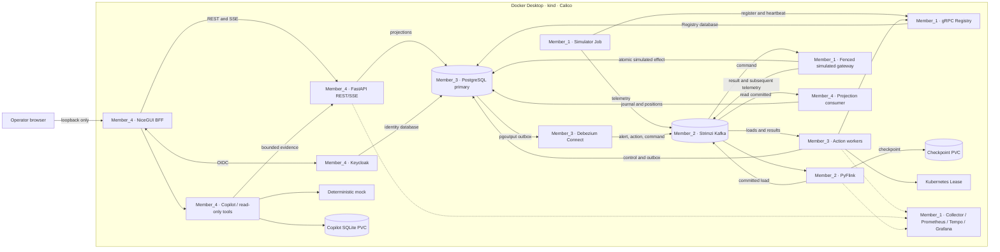
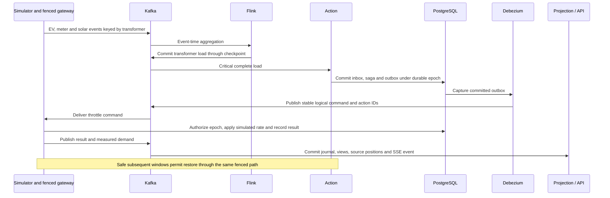

# Implemented local architecture

Both kind profiles run on one Docker Desktop node with Calico. The dev profile runs one Kafka broker. Review uses three combined KRaft brokers on the same node and adds application replicas. Flink runs one aggregation task in either profile. PostgreSQL uses separate databases and roles, with a narrow fenced gateway in the control database.

## Contribution and presentation mapping

These labels identify ownership on the shared implementation computer.

| Owner | Source and deployment | Evidence to present |
|---|---|---|
| Member_1 | [Registry and simulator](../../member1/README.md), [observability](../../infra/observability/README.md) | Registered edge inputs, measured rate reduction, duplicate-safe effects, incident metric/trace/log packet |
| Member_2 | [Aggregation](../../member2/README.md), Kafka/Topic/Flink resources in [kind](../../infra/kind/README.md) | Fixture totals, event-time revisions, broker profile, checkpoint and TaskManager recovery |
| Member_3 | [Action](../../member3/README.md), PostgreSQL, CDC, Lease/RBAC, fenced gateway transaction | Action and command IDs, stale-epoch rejection evidence, outbox delivery, logical backup/restore |
| Member_4 | [Operations API](../../member4/README.md), [UI](../../dashboard/README.md), [identity](../../identity/README.md), [Investigator](../../services/copilot/README.md) | Replay equality, REST/SSE, live Viewer and Operator sessions, cited evidence and role denial |
