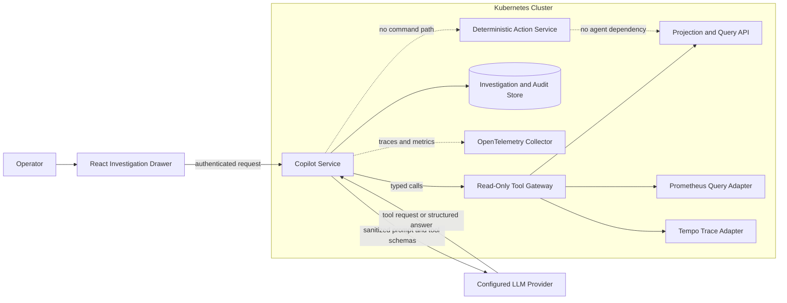
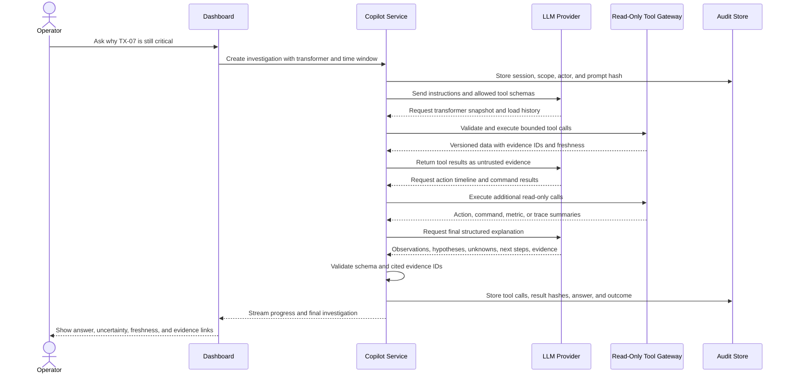

# Evidence-Grounded Grid Incident Investigator

## Purpose

The Grid Incident Investigator is a bounded, read-only agent that helps an operator understand overloads and distributed-system failures. It can answer questions such as “Why is this transformer still critical?”, “Did throttling produce the expected reduction?”, and “Is the stale dashboard caused by the grid or by stream-processing delay?”

The agent is an operations aid, not part of the control plane. Transformer load, threshold decisions, charger selection, commands, and recovery remain deterministic and continue to work when the model provider is unavailable. The final demonstration includes a deterministic mock-provider mode so an external API outage cannot block the core project.

## Scope

### Required thin slice

- One investigator agent with a provider-neutral model adapter
- OpenAI-compatible, Gemini-compatible, or deterministic mock provider selected by configuration
- Seven allowlisted, read-only tools with typed inputs and bounded outputs
- Incident-scoped conversation state and a complete tool/evidence audit trail
- Dashboard investigation drawer with progress, answer, evidence, uncertainty, and failure states
- Fixed evaluation cases covering correct investigation, partial failure, stale data, prompt injection, and provider outage
- Kubernetes Deployment, Service, NetworkPolicy, Secrets, probes, resource limits, and OpenTelemetry instrumentation

### Explicitly excluded

- LLM calculation of authoritative load or thresholds
- Model-generated charger selection or command publication
- Direct SQL, PromQL, Kafka, shell, or Kubernetes tools
- Autonomous policy/configuration changes
- Persistent personal memory or training on operator conversations
- A multi-agent swarm, vector database, fine-tuning pipeline, or model-provider failover system

## Architecture

The Copilot Service never receives domain-table, Kafka, Kubernetes, or observability-backend credentials. It can reach only the internal Tool Gateway, the configured model endpoint, OpenTelemetry, and a repository role limited to investigation/audit tables. The Tool Gateway executes predefined queries using the caller's identity and returns freshness/version metadata with every result.

## Investigation workflow

An investigation has a maximum wall-clock deadline, tool-call count, result size, and model-turn count. A timeout produces a partial investigation that states what was and was not checked; it never fabricates a successful diagnosis.

## Read-only tool contract

| Tool | Input | Bounded output | Purpose |
|---|---|---|---|
| `get_transformer_snapshot` | Transformer ID | Current state, load, capacity, version, freshness | Establish authoritative current state |
| `get_load_history` | Transformer ID, approved time window | Limited load windows and revisions | Identify overload, recovery, late data, or staleness |
| `get_action_timeline` | Transformer ID, approved time window | Alerts, plans, transitions, policy versions | Explain deterministic control decisions |
| `get_command_results` | Action ID | Limited commands, outcomes, deadlines, reduction | Confirm whether the plan took effect |
| `get_stream_health` | Approved component names | Kafka lag, watermark, checkpoint, readiness summaries | Separate grid conditions from processing failure |
| `get_metric_window` | Metric enum, entity ID, approved time window | Downsampled values and threshold metadata | Test a specific operational hypothesis |
| `get_trace_summary` | Trace or correlation ID | Redacted spans, durations, errors, and service path | Explain a slow or failed distributed operation |

The model cannot supply arbitrary query text. IDs, metric names, time ranges, limits, and component names are validated against allowlists. Tool responses include `observed_at`, source version, freshness state, evidence ID, and truncation status.

The executable interface is specified in the [agent tool and evidence contracts](../contracts/AGENT_TOOL_CONTRACTS.md).

## Agent state and output

Investigation status is `QUEUED`, `RUNNING`, `COMPLETED`, `PARTIAL`, `FAILED`, or `CANCELLED`. Incident-scoped state contains the authenticated actor, initial entity/time scope, prompt hash, selected provider/model identifier, tool calls, evidence references, token/latency metadata, and final outcome. Raw secrets and unrestricted log payloads are never stored.

The final answer follows a server-validated structure:

- `summary`: short operator-facing conclusion
- `observations`: claims directly supported by evidence
- `hypotheses`: possible explanations clearly labeled as hypotheses
- `unknowns`: missing, stale, conflicting, or truncated data
- `recommended_next_steps`: read-only checks or human-run runbook steps
- `evidence`: evidence ID, source, entity, timestamp, and deep link

A claim that references a nonexistent evidence ID is rejected or marked unsupported before display. Model text never becomes authoritative domain state.

## Provider abstraction and availability

The Copilot Service owns a small adapter interface for model request, tool call, structured output, cancellation, usage, and error mapping. The project configures one external provider for the demonstration; supporting both OpenAI and Gemini at runtime is not required. Provider-specific model names and credentials remain configuration rather than domain logic.

The deterministic mock provider replays expected tool plans and answers for seeded incidents. It is used for automated tests and as the final-demo fallback. The core grid system does not retry or fail over because of an agent-provider outage.

## Security and guardrails

- Treat operator prompts, telemetry, logs, trace attributes, tool results, and model output as untrusted.
- Use a fixed system policy and server-owned tool definitions; retrieved content cannot redefine instructions or authorize tools.
- Use strict schemas, allowlisted tools, server-side authorization, deadlines, rate limits, and bounded result sizes.
- Forward only synthetic, redacted fields needed for an investigation.
- Do not expose provider credentials to the browser or include them in logs, traces, prompts, or audit output.
- Deny all write tools. Scenario start/stop and configuration changes remain existing human-operated UI workflows.
- Display an AI-generated label, evidence freshness, uncertainty, and provider failure explicitly.
- Retain investigation state for a bounded class-project period and allow it to be deleted independently of authoritative grid history.

## Resilience and observability

The Copilot Service has separate time budgets for the whole investigation, model calls, and internal tools. Provider calls use bounded retries only for safe transient failures, with jitter, a circuit breaker, and a concurrency/rate-limit bulkhead. Tool errors are returned as evidence gaps instead of silently retried across the full workflow.

OpenTelemetry spans cover the investigation, each model turn, and each tool call without recording sensitive prompt content. Required metrics include investigation count/outcome, duration, model/tool latency, tool errors, provider throttling, circuit state, token usage, evidence count, unsupported-claim rejection, cancellations, and mock-provider use. `investigation_id` stays in logs/traces rather than high-cardinality metric labels.

## Evaluation plan

Seeded cases cover a genuine overload, late telemetry correction, Kafka/Flink lag, partial command acknowledgement, stale-leader rejection, provider timeout, unauthorized tool request, and prompt injection embedded in retrieved text. Each case defines expected tools and evidence rather than requiring one exact paragraph.

The evaluation records:

- Required and irrelevant tool selection
- Factual claims supported by evidence
- Unsupported or contradictory claims
- Correct handling of stale, partial, and missing data
- Denial of unavailable or write-capable tools
- Prompt-injection resistance
- End-to-end latency, provider/tool errors, and token usage
- Whether an operator can understand, verify, and reject the conclusion

Acceptance requires zero successful write attempts, zero invented evidence IDs, and correct uncertainty for provider or evidence failure. Model quality is reported separately from deterministic platform correctness.

Detailed cases and scoring are defined in the [agent evaluation plan](../testing/AGENT_EVALUATION_PLAN.md).

## Delivery order

The tool contracts, mock provider, evaluation fixtures, and UI states are designed early, but external-model integration starts only after the deterministic telemetry-to-command loop and observability queries work. This prevents the agent from hiding missing platform behavior while keeping it part of the planned final project.

## Provider references

The provider adapter follows the structured tool-calling flow documented by the [OpenAI API](https://developers.openai.com/api/docs/guides/function-calling) and [Gemini API](https://ai.google.dev/gemini-api/docs/function-calling). Provider-specific capabilities remain behind the adapter and do not change domain or tool contracts.
