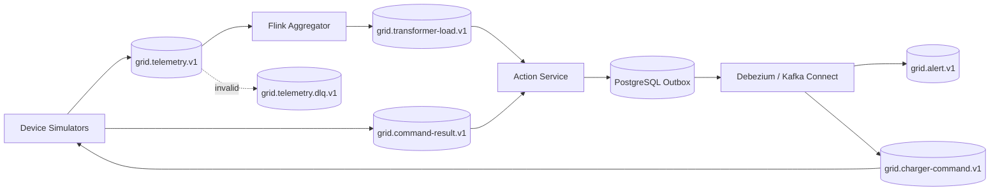
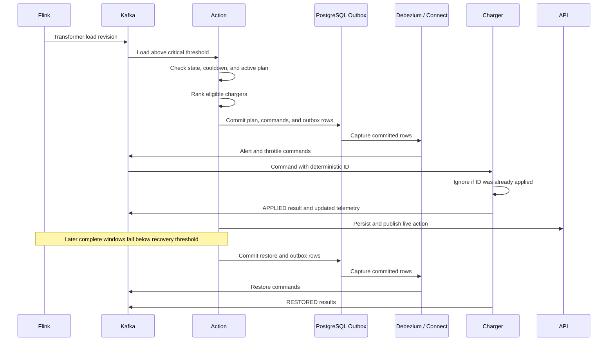

# Data Flow and Stream Semantics

## 1. Topic topology



| Topic | Key | Producer | Primary consumer | Proposed retention |
|---|---|---|---|---|
| `grid.telemetry.v1` | `transformer_id` | Simulators | Flink aggregation | 24 hours |
| `grid.transformer-load.v1` | `transformer_id` | Flink | Action service, API projection | 24 hours |
| `grid.alert.v1` | `transformer_id` | Debezium from Action outbox | API projection | 7 days |
| `grid.charger-command.v1` | `device_id` | Debezium from Action outbox | EV simulators | 24 hours |
| `grid.command-result.v1` | `device_id` | EV simulators | Action service | 7 days |
| `grid.telemetry.dlq.v1` | original key | Validation path | Operator review | 7 days |

Retention and partition counts remain proposals until load testing. The architecture-review profile targets three Kafka brokers, replication factor three for critical topics, `min.insync.replicas=2`, and producer acknowledgement settings selected explicitly per topic. A lightweight developer profile may use one broker but cannot be presented as highly available. Schema fields are canonical in the event-contract document.

## 2. Telemetry lifecycle

1. A simulator creates an event with a unique event ID and UTC event timestamp.
2. Kafka records the event in the partition selected by `transformer_id`.
3. Flink validates the envelope and device-specific payload.
4. Valid events update keyed state; invalid events go to the DLQ with a reason.
5. A 5-second tumbling event-time window calculates category totals and net load.
6. A watermark 10 seconds behind the greatest observed event time allows common network delay.
7. Events arriving within 30 seconds after a window closes produce a corrected load revision.
8. Events later than the allowed-lateness boundary are retained for audit but do not silently rewrite control history.

## 3. Load calculation

All power values use kilowatts. Consumption is positive and generation is negative.

```text
net_load_kw = meter_demand_kw + ev_demand_kw + solar_generation_kw
utilization_pct = (net_load_kw / transformer_capacity_kw) × 100
```

The load event reports the window bounds, revision, number of contributing devices, late-event count, and whether the window is considered complete. A correction has the same logical window ID and a higher revision.

## 4. Overload and recovery flow



## 5. Processing guarantees

- Kafka provides durable at-least-once delivery to consumers and ordering within a partition.
- Flink checkpoints are intended to provide exactly-once state and Kafka output for committed windows.
- Database projections use unique event IDs and upserts to tolerate reprocessing.
- Device commands are delivered at least once. Exactly-once physical effect is approximated through deterministic command IDs and a device-side processed-command ledger.
- Acknowledging a Kafka record does not prove that a simulated charger changed its rate; the command-result event is the explicit outcome.
- Action/command events are published from a transactional outbox; state-changing consumers use an idempotent inbox.
- Trace context and correlation/causation IDs travel in Kafka headers so asynchronous processing can be reconstructed without relying on wall-clock order.

## 6. Correction policy

A corrected window may change a transformer's historical load and, if still operationally relevant, may change its current state. It must not erase previous alerts or commands. Instead, the system stores the new revision and records whether a prior decision would have differed. This preserves an honest audit trail.

## 7. Backpressure and overload

If processing cannot keep up, Kafka retains telemetry while Flink consumer lag rises. The UI labels load data stale when its age exceeds a configured limit. The action service must not make a new automatic decision from stale load data; it holds the last safe plan, raises a data-quality alert, and waits for a fresh complete window.

## 8. Configuration flow

Transformer capacity and policy changes go through the API, are validated, versioned, stored, and audited. The action service evaluates each load with the policy version effective at processing time. Configuration is not sent through the raw telemetry topic.
