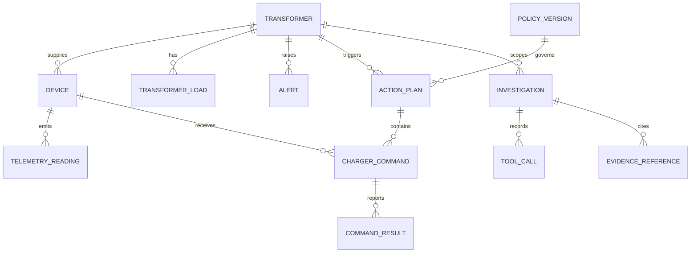
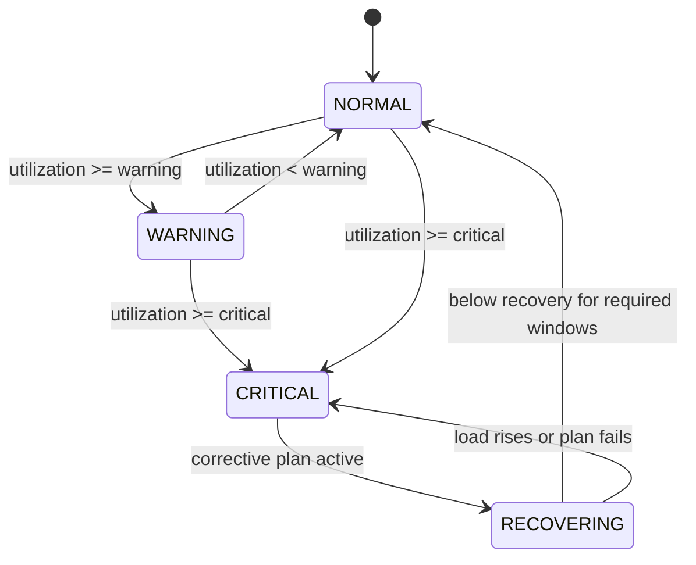
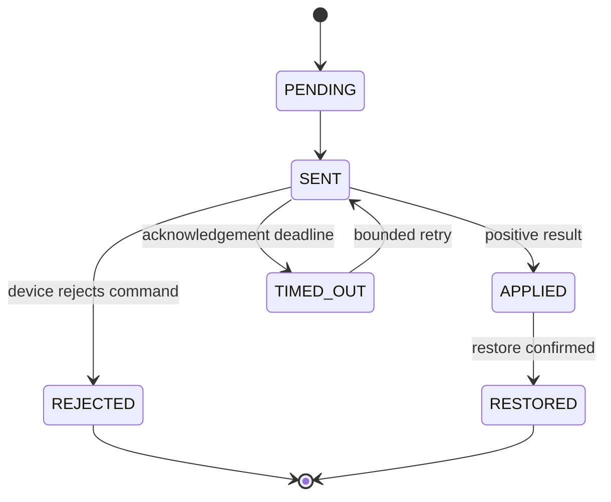
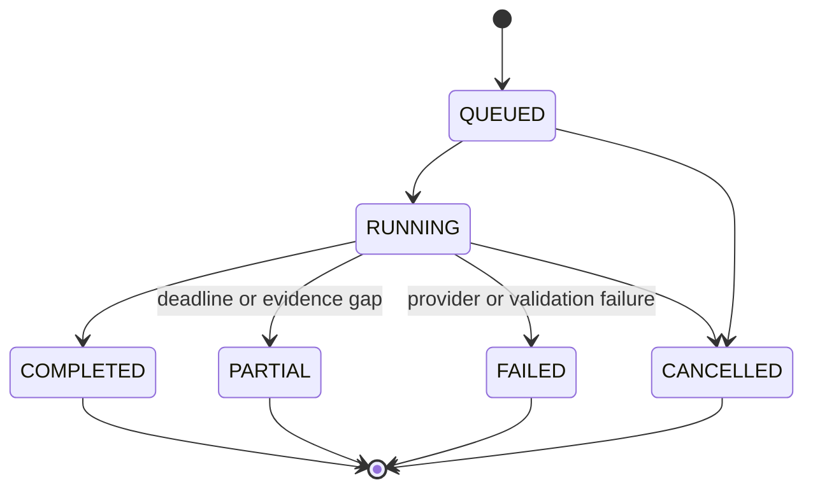

# Data Model

## 1. Conceptual relationships

## 2. Core records

| Record | Key fields | Purpose |
|---|---|---|
| Transformer | ID, name, capacity kW, region, thresholds, enabled | Grid asset being protected |
| Device | ID, transformer ID, type, controllable, priority, status | Simulated field endpoint |
| Telemetry reading | Event ID, device ID, event time, ingest time, power kW, quality | Raw time-series input |
| Transformer load | Window ID, revision, totals, utilization, completeness | Aggregated grid state |
| Alert | ID, transformer ID, severity, status, reason, timestamps | Operator-visible condition |
| Action plan | ID, trigger load revision, policy version, reduction target, status | Explainable control decision |
| Charger command | ID, action ID, device ID, type, rate, expiry, status | Requested device change |
| Command result | Event ID, command ID, outcome, applied rate, reason | Device acknowledgement |
| Policy version | ID, thresholds, cooldown, selection rules, effective time | Versioned decision configuration |
| Scenario run | ID, scenario type, seed, scale, status, timestamps | Reproducible simulation run |
| Audit event | ID, actor, action, entity, before/after summary, time | Configuration and operator history |
| Investigation | ID, actor, entity/time scope, prompt hash, provider mode, status, timestamps | Bounded agent workflow and final structured result |
| Tool call | ID, investigation ID, tool name, arguments hash, status, latency, result hash | Auditable read-only agent execution without storing unrestricted payloads |
| Evidence reference | ID, investigation ID, source type, entity/correlation reference, observed time, freshness, deep link | Verifiable support for an agent claim |

## 3. State machines

### Transformer

### Command

### Investigation

## 4. Time and units

- IDs are UUIDs unless a deterministic command ID is required.
- Timestamps use UTC ISO 8601 in JSON and timezone-aware database types.
- Power uses kilowatts; energy, if added later, uses kilowatt-hours.
- Solar generation is negative power; consumption is positive.
- Percentages are stored as numeric values from 0 through values above 100, not fractions.

## 5. Retention proposal

Raw telemetry is retained for the short duration needed for replay and the final demonstration. Aggregated load, alerts, actions, command results, configuration, and authoritative audit records are retained for the life of the project. Agent investigations have a shorter configurable retention and may be deleted without changing grid history. Retention must be configurable so load tests do not fill local disks.

## 6. Integrity rules

- Device IDs reference an existing transformer.
- A command targets one controllable EV charger.
- A load revision is unique by transformer, window, and revision number.
- Event IDs, action IDs, and command IDs are unique.
- Stored actions are append-only except for explicit lifecycle status updates.
- Historical actions are never deleted when corrected telemetry arrives.
- Every displayed agent evidence ID belongs to the same investigation and resolves to a recorded tool result/deep link.
- Investigation/tool records cannot create or mutate policies, action plans, commands, or scenario runs.
