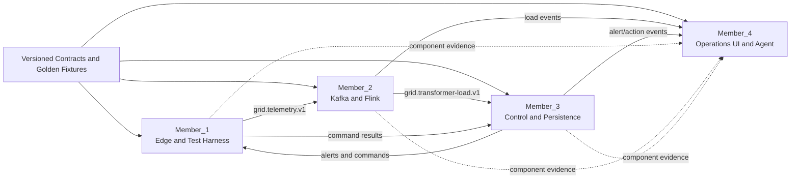

# Dependency Minimization and Independent Workstreams

## Goal

The completed platform is intentionally integrated, but day-to-day implementation must not require another teammate's unfinished service. Members depend on versioned contracts and deterministic fixtures, not on another member being available or having a running environment.

The team will preserve only three kinds of dependency:

1. **Contract dependency:** producer and consumer agree on a schema and behavior.
2. **Pairwise integration dependency:** two completed components are tested together at a scheduled checkpoint.
3. **Final-system dependency:** all components run together for the Kubernetes demonstration.

Direct source-code imports, shared mutable tables, undocumented message assumptions, and one teammate deploying or instrumenting everyone else's workloads are prohibited.

## Target boundaries

Solid arrows are final runtime contracts. The same messages are available as fixtures, so no arrow is a prerequisite for independent development. The agent consumes projections and bounded observability summaries owned by Member_4; it does not call Members 1–3 services directly.

## Versioned contract bundle

The contract bundle is frozen before parallel implementation and contains:

- JSON Schemas for Kafka events
- Protobuf definitions for the Device Registry
- OpenAPI definitions for operator-facing REST endpoints
- Agent tool/evidence schemas
- Valid, invalid, duplicate, delayed, corrected, and replay examples
- Golden expected outputs and state transitions
- Topic keys, units, timestamp rules, error categories, and compatibility policy

Contract changes require the affected producer and consumer to approve one reviewed pull request. Additive compatible changes do not block unrelated work. Breaking changes create a new major schema/topic version and migration fixture.

## Independently testable workstreams

| Member | Owned runtime slice | Standalone input | Standalone proof |
|---|---|---|---|
| Member_1 | Simulators, gRPC Registry, Kafka producers, charger command consumers | Command fixtures, mock registry clients, local Kafka | Valid telemetry/results, backpressure, duplicate-safe device effects, deterministic scenarios |
| Member_2 | Strimzi/Kafka topology and Flink aggregation | Telemetry fixtures and local Kafka/Flink test profile | Golden load events, late revisions, DLQ behavior, checkpoint restore, replay correctness |
| Member_3 | Action Service, lease/fencing, PostgreSQL control schema, outbox/inbox, Debezium | Load fixtures, fake Registry server, command-result fixtures | Deterministic plans, one logical effect, outbox publication, recovery, stale-epoch rejection |
| Member_4 | Projection/API/SSE, UI, Keycloak integration, Tool Gateway, Copilot Service | Recorded domain events, mock identity, mock tool/model responses | Convergent read models, cursor recovery, UI states, grounded investigation, provider isolation |

Each workstream owns its unit tests, component tests, Kubernetes resources, ServiceAccount/RBAC, NetworkPolicy, probes, resource limits, metrics, traces, structured logs, dashboard panels, runbook entry, and one fault experiment.

## Database isolation

One PostgreSQL instance is sufficient for student hardware, but it is not a shared-data shortcut. Separate databases or schemas and least-privilege roles provide logical ownership:

| Owner | Logical store | Allowed access |
|---|---|---|
| Member_1 | `registry` | Registry migrations and registry service only |
| Member_3 | `control` | Action, saga, inbox/outbox, policy, and command state |
| Member_4 | `projection` | Rebuildable query models populated from Kafka events |
| Member_4 | `copilot_audit` | Investigation/tool/evidence audit records only |

Member_2 does not write PostgreSQL. Flink publishes `grid.transformer-load.v1`; Member_4 persists load history through its projection consumer. Member_4 does not read Member_3's control tables for normal queries. Shared identifiers and facts cross boundaries through versioned events.

## Platform ownership without a bottleneck

Shared infrastructure is divided rather than assigned wholesale to Member_4:

| Platform area | Owner | Other members' responsibility |
|---|---|---|
| Kafka, Strimzi, topics, Flink Operator | Member_2 | Supply producer/consumer requirements and test compatibility |
| PostgreSQL deployment and Debezium/Kafka Connect | Member_3 | Own migrations and credentials only for their logical store |
| CI scenario runner, Locust/Toxiproxy harness, contract fixtures, OTel Collector, Prometheus/Grafana/Tempo | Member_1 | Contribute component commands, instrumentation, panels, and expected results |
| Gateway, Keycloak, product SLO views, and Copilot/API/UI platform | Member_4 | Use published auth/telemetry conventions and independently mock them |
| Component Kubernetes resources | Each component owner | Member_4 supplies shared conventions, not manifests for everyone |
| Final architecture-review overlay | Shared, coordinated by Member_4 | Every owner proves their slice works before inclusion |

## Integration cadence

Integration is incremental rather than deferred to the final weeks:

1. **Contract CI on every change:** validate schemas, examples, Protobuf/OpenAPI generation, and golden fixtures.
2. **Standalone component gate:** every member demonstrates their slice using only local dependencies and fixtures.
3. **Pairwise gates:** Member_1↔Member_2, Member_2↔Member_3, Member_3↔Member_1, then event topics↔Member_4.
4. **Kubernetes gate:** independently verified workloads join the shared cluster overlay.
5. **End-to-end and failure gate:** the full overload-to-recovery workflow, agent investigation, and failure experiments run together.

A pairwise failure does not stop unrelated work; the contract fixture reproducing it is added to both sides before the fix is accepted.

## Scope retained for value and grading

- Simulated closed-loop load reduction demonstrates the business outcome.
- Kafka/Flink demonstrate messaging, partitioning, event time, state, replay, and recovery.
- gRPC Registry demonstrates synchronous communication and deadlines.
- Lease/fencing, saga, outbox/inbox, and Debezium demonstrate coordination and distributed transaction failure handling.
- Kubernetes demonstrates discovery, reconciliation, replicas, policy, and failure behavior.
- OpenTelemetry, Prometheus, Grafana, Tempo, and structured logs provide operational evidence.
- Keycloak and least-privilege policies demonstrate security boundaries.
- The read-only agent demonstrates bounded tool calling, evaluation, and human verification without controlling the grid.

## Removed complexity

The required design does not include a runtime schema registry, a PostgreSQL operator, Loki, KEDA, a database read replica, anomaly detection, multi-provider comparison, or additional agent features. These components add installation, resources, and ownership dependencies without strengthening the primary business story or required course evidence.

