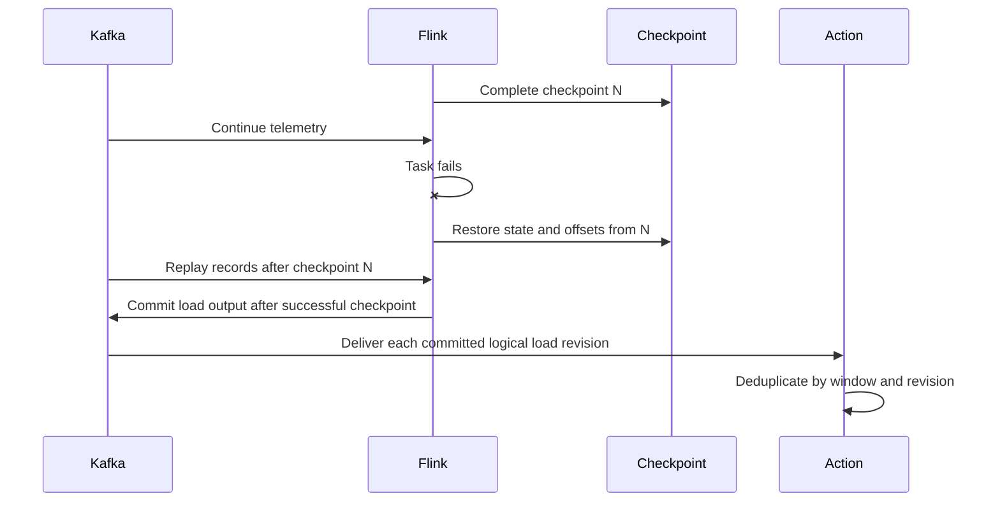

# Failure Handling and Recovery

## 1. Principles

The system prefers a visible degraded state over an unsafe decision based on missing or stale data. Retries are bounded, events are deduplicated, and operator-visible history is not rewritten to hide earlier decisions.

## 2. Failure matrix

| Failure | Detection | Planned behavior | Operator indication |
|---|---|---|---|
| Simulator offline | Heartbeat/telemetry age | Mark device offline; exclude it from controllable candidates | Device warning and reduced data completeness |
| Malformed telemetry | Schema validation | Send to DLQ; continue valid records | DLQ count and validation reason |
| Late telemetry | Event time vs watermark | Apply within allowed lateness; otherwise audit only | Corrected revision or very-late counter |
| Duplicate telemetry | Event ID/state | Ignore duplicate logical event | Deduplication metric |
| Kafka unavailable | Producer/consumer errors | Retry with backoff; buffer only within bounded client limits | Platform degraded and data stale |
| Flink task failure | Runtime/checkpoint status | Restart from last successful checkpoint | Processing recovering; lag displayed |
| Database unavailable | Health check/write failure | Continue stream where possible; retry projections; stop configuration writes | History unavailable, live state marked partial |
| Action service restart | Consumer offsets and DB state | Rebuild active plans; deduplicate commands | Control service recovering |
| Command result missing | Deadline | Retry within policy, then mark timed out and choose safe fallback | Action shows partial/failed outcome |
| API unavailable | UI request/SSE failure | UI retries with backoff and keeps last snapshot marked stale | Connection banner and timestamp |
| SSE disconnect | Heartbeat timeout | Reconnect using last event cursor, then refresh snapshot | Reconnecting indicator |
| Kubernetes pod loss | Readiness/endpoints and pod status | Route to ready replicas and reconcile desired state | Replica/recovery alert and measured interruption |
| Action leader loss/partition | Lease expiry and epoch | Elect new leader; reject commands from stale epoch | Leader transition and fencing-rejection event |
| Registry latency/outage | gRPC deadline and breaker | Bound attempts; pause unsafe new plans | Breaker/degraded capability alert |
| Telemetry backend outage | Export queue/drop signals | Business path continues within bounded telemetry buffers | Observability-degraded alert |
| Model provider timeout/rate limit | Provider error, deadline, or breaker | Return partial/unavailable investigation or explicit mock mode; do not affect core services | Agent-only status and retry guidance |
| Agent tool unavailable | Tool deadline/error | Preserve completed evidence, label the gap, and stop after bounded attempts | Partial result with missing source |
| Copilot pod loss | Pod/readiness and interrupted request | Kubernetes reconciles; investigation fails visibly or resumes only from durable bounded state | Investigation interrupted/recovering; grid remains healthy |
| Prompt/tool injection | Policy/schema validation | Treat content as data and deny unavailable/write/arbitrary-query tools | Security denial in audit without executing the request |

## 3. Aggregator restart

## 4. Command safety

A command includes a deterministic ID, target, desired rate, issue time, expiry time, and policy/action reference. A charger stores processed command IDs for at least the command topic's replay horizon. Repeating an applied command returns the prior outcome without applying the reduction again. Expired, invalid, or wrong-device commands are rejected.

The action service limits retries and never assumes success from message publication alone. If insufficient chargers acknowledge a plan, it raises an incomplete-action alert rather than repeatedly lowering rates without bound.

## 5. Stale-data policy

The platform records the age and completeness of the latest load state. Automatic actions require a fresh, complete-enough window. When data is stale, the system preserves already applied safe limits, suspends new automatic plans, and alerts the operator. It does not restore charging solely because telemetry disappeared.

## 6. Recovery tests

The final test plan must include:

1. Kill and restart the Flink task during a known event stream.
2. Redeliver the same telemetry event and verify no double count.
3. Redeliver the same command and verify one logical device effect.
4. Disconnect the UI live stream and verify snapshot recovery.
5. Pause command results and verify bounded retry plus timeout.
6. Inject invalid records and verify the healthy partition continues.
7. Make the database temporarily unavailable and document which paths continue.
8. Fail API readiness and delete a pod; measure Kubernetes routing and reconciliation.
9. Kill the Action leader and reject a delayed stale-epoch command.
10. Stop one broker in the replicated profile and record topic behavior.
11. Slow gRPC until the breaker opens and verify safe degradation.
12. Attempt a conflicting policy update and verify optimistic-version rejection without corrupting current state.
13. Time out the model provider and delete a Copilot pod; verify explicit agent degradation and an unaffected control loop.
14. Inject tool-like instructions into retrieved evidence and request a write/arbitrary query; verify denial and audit evidence.
