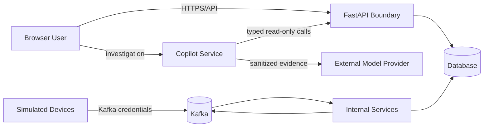

# Security, Privacy, and Safety Design

## 1. Scope

The project uses synthetic data and simulated devices. It is not authorized to connect to real chargers, smart meters, utility networks, or customer records. Security controls demonstrate sound software boundaries but do not claim production utility compliance.

## 2. Trust boundaries

The browser never connects directly to Kafka or the database. Simulator identities may publish telemetry and read commands only for the planned demo environment. Internal service ports should not be exposed outside the local network unless required.

## 3. Principal threats and controls

| Threat | Planned control |
|---|---|
| Forged telemetry | Cluster-internal broker access, producer identity/configuration, schema validation, device registry, and audit fields |
| Replay or duplicate events | Unique event IDs, deduplication, timestamps, and retention-bounded replay handling |
| Unauthorized control command | Service-only producer access, target validation, command expiry, and audit trail |
| Repeated physical effect | Deterministic command ID and device-side idempotency ledger |
| Unsafe operator change | Role check, input bounds, confirmation, policy versioning, and audit record |
| Secret exposure | Kubernetes secret delivery, ignored local files, safe examples, redaction, and secret scanning |
| Resource exhaustion | Payload limits, bounded retries, rate limits, retention limits, and backpressure metrics |
| Misleading stale UI | Freshness timestamps, heartbeat, stale state, and authoritative refresh |
| Prompt/tool injection | Fixed server policy, retrieved-data isolation, typed allowlisted tools, strict schemas, and adversarial fixtures |
| Model-driven control or privilege escalation | No write tools, no control-plane path, server-side authorization, and NetworkPolicy/RBAC denial |
| Data or credential leakage to provider | Synthetic/redacted evidence, field allowlists, provider secret isolation, and prompt/log review |
| Unsupported agent claim | Evidence-ID validation, observations/hypotheses separation, freshness display, and operator verification |

## 4. Safety constraints

- Commands can target only simulated EV chargers registered as controllable.
- Rate values must remain within the device's configured minimum and maximum.
- Commands expire and cannot be applied after their validity window.
- Automatic decisions stop when input state is stale or materially incomplete.
- Restore is not triggered merely by loss of telemetry.
- Scenario controls clearly indicate that they affect synthetic data only.
- Agent text cannot update domain records, approve scenarios, change policy, or publish commands.
- Provider or Copilot failure cannot change Action Service readiness or suspend deterministic protection.

## 5. Data handling

No names, addresses, VINs, account numbers, or real location coordinates are required. Device and transformer IDs are synthetic. Generated telemetry may be deleted and regenerated. Logs should avoid dumping complete payloads by default and must never contain credentials. Only allowlisted synthetic fields and redacted summaries may leave the cluster for an external model provider. Investigation prompts, tool-result hashes, and provider metadata have a bounded retention independent of authoritative grid history.

## 6. Secrets and repository hygiene

Never commit `.env` files, passwords, tokens, private keys, database volumes, generated telemetry, or exported dashboards containing secrets. Example configuration uses placeholders. Any accidental secret exposure requires revocation before history cleanup.

## 7. Class MVP controls

The Kubernetes deployment plans a local OIDC provider with Viewer, Operator, and Administrator roles; Kubernetes ServiceAccounts/RBAC; NetworkPolicies; Secrets; non-root containers; minimal ports; and negative authorization tests. The browser accesses only the Gateway/API boundary, while data and broker services remain cluster-internal. The Copilot Service has restricted model-provider egress and can call only the read-only Tool Gateway. Full Kafka SASL/TLS/ACL administration is stretch hardening rather than a completion requirement.

## 8. Future production considerations

Real deployment would additionally require enterprise federation, managed key rotation, hardened mTLS workload identity, encryption-at-rest governance, tamper-resistant audit storage, formal safety analysis, utility protocol review, privacy review, and regulatory assessment. These remain non-goals for the class MVP.
