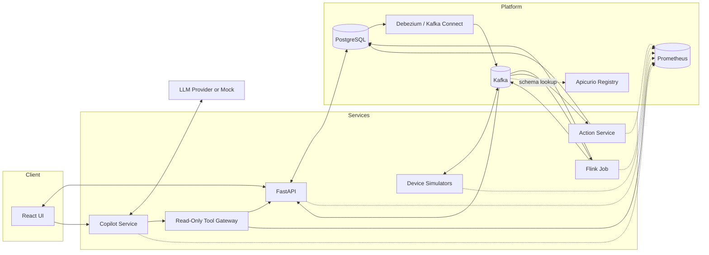
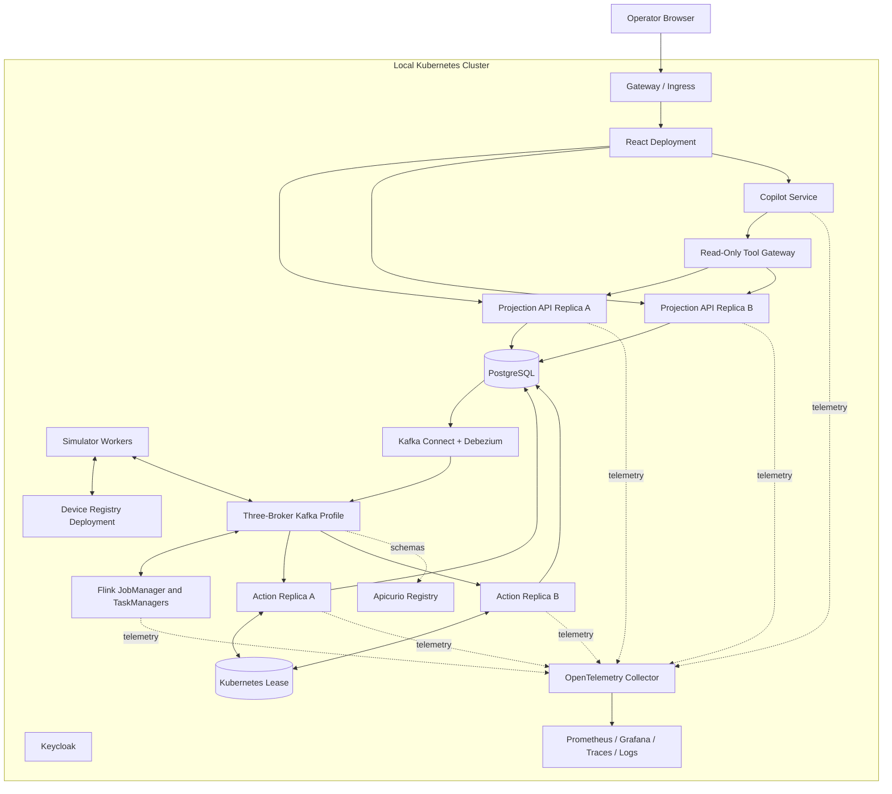

# System Design

## 1. Purpose

The platform demonstrates how a utility could observe local grid demand and coordinate flexible EV charging before a neighborhood transformer becomes overloaded. It is a simulation and decision-support project, not a controller for real electrical equipment.

## 2. Design goals

- Ingest telemetry from at least thousands of simulated devices without a single global processing bottleneck.
- Calculate a defensible net load for every transformer despite delayed and out-of-order readings.
- Detect warning and critical conditions within a bounded time.
- Reduce demand with targeted, reversible, duplicate-safe charging commands.
- Recover processing state after a component restart.
- Run the complete final demonstration as independently deployable workloads in Kubernetes.
- Demonstrate discovery, replica routing, health probes, reconciliation, leader failover, and stale-worker rejection.
- Make every alert and action explainable to an operator.
- Correlate metrics, traces, and structured logs around one logical grid operation.
- Provide a clean, dynamic UI plus separate engineering observability and SLOs.
- Provide a read-only agent that can investigate an incident through typed tools and cite the evidence behind its conclusions.

## 3. Functional requirements

| ID | Requirement |
|---|---|
| FR-01 | Simulate EV chargers, smart meters, and solar generators assigned to transformers. |
| FR-02 | Publish versioned telemetry with device time and ingestion time. |
| FR-03 | Partition and process telemetry by transformer. |
| FR-04 | Calculate demand, solar generation, EV demand, net load, and utilization per window. |
| FR-05 | Classify transformers as `NORMAL`, `WARNING`, `CRITICAL`, or `RECOVERING`. |
| FR-06 | Select eligible chargers and issue throttle or restore commands. |
| FR-07 | Track command delivery and device acknowledgement. |
| FR-08 | Store load history, alerts, actions, and configuration. |
| FR-09 | Present live grid status and scenario controls in a browser UI. |
| FR-10 | Demonstrate late data, duplicates, restart recovery, and degraded components. |
| FR-11 | Deploy services to Kubernetes with probes, resource policies, discovery, and multiple replicas where safe. |
| FR-12 | Demonstrate action-service leader election and fencing after failover. |
| FR-13 | Correlate a control action across HTTP/gRPC, Kafka, Flink, persistence, and the UI. |
| FR-14 | Let an authenticated operator run a bounded read-only investigation that reports observations, hypotheses, unknowns, and evidence references. |

## 4. Proposed quality targets

These are design targets to validate on the team's agreed demo machine; they are not measured results.

| Quality | Proposed target |
|---|---|
| Scale | 10,000 simulated devices across at least 20 transformers |
| Steady ingestion | 5,000 telemetry events per second for 10 minutes |
| Detection latency | P95 under 8 seconds with a 5-second aggregation window |
| UI freshness | New accepted load state visible within 2 seconds of API publication |
| Correctness | Fixture windows match independently calculated expected totals |
| Duplicate safety | Replayed input or commands create no duplicate logical control effect |
| Recovery | Aggregator resumes from a checkpoint within 60 seconds in the demo environment |
| Availability behavior | UI clearly labels stale or unavailable data rather than presenting it as current |
| Agent grounding | Every displayed factual claim references returned evidence; invented evidence IDs are rejected |
| Agent safety | Zero successful write-tool calls; core control remains available when the model provider is disabled |

## 5. Logical components

| Component | Responsibility | Does not own |
|---|---|---|
| Device simulators | Generate telemetry, apply charger commands, publish results | Grid aggregation or charger selection |
| Device registry | Typed gRPC registration and capability lookup with deadlines | Telemetry aggregation or control decisions |
| Kafka | Durable ordered logs within partitions | Business rules or long-term query storage |
| Strimzi | Reconcile Kafka clusters, topics, users, and Kafka Connect resources | Topic semantics or application correctness |
| Flink aggregation | Validate, window, aggregate, checkpoint, and publish transformer load | Threshold policy or UI views |
| Flink Kubernetes Operator | Reconcile Flink deployments, upgrades, savepoints, and recovery | Aggregation semantics or state correctness |
| Action service | Lead a fenced control partition, run the control saga, and publish commands through an outbox | Recalculating raw transformer load |
| Debezium/Kafka Connect | Capture committed outbox rows and route them to Kafka | Domain transactions or consumer idempotency |
| Apicurio Registry | Store event schemas and enforce compatible evolution | Business validation rules |
| PostgreSQL | Durable control state, inbox/outbox, configuration, and time-indexed history | Event transport or leader election |
| Projection/API service | Idempotent CQRS views, stable REST/configuration API, and cursor-based SSE | Stream-processing or control-policy ownership |
| Read-only Tool Gateway | Execute allowlisted entity, health, metric, and trace-summary queries with authorization and bounds | Arbitrary SQL, PromQL, Kafka, shell, or Kubernetes access |
| Copilot service | Orchestrate model turns and tools, validate evidence-backed output, and audit investigations | Authoritative grid state or control actions |
| Configured model provider | Select tools and produce a structured explanation from supplied evidence | Tool execution or access to internal credentials |
| React dashboard | Operator workflows and live visualization | Domain-state inference |
| Kubernetes | Scheduling, discovery, probes, reconciliation, replica management, and policy | Business correctness or durable workflow state |
| OpenTelemetry stack | Metrics, traces, structured logs, SLO evidence, and incident correlation | Primary operator workflow |

## 6. Runtime architecture

For final deployment, every major component runs as a Kubernetes workload with a stable service boundary. The browser accesses only Gateway-routed API and Copilot endpoints; it does not connect directly to Kafka, Flink, or the database. Docker Compose is an optional developer convenience and is not the architecture-review target.

## 7. Transformer policy

Each transformer has a rated capacity and configurable thresholds expressed as a percentage of that capacity. Proposed defaults are warning at 80%, critical at 95%, and recovery below 75% for two consecutive complete windows. The lower recovery threshold provides hysteresis. A cooldown prevents issuing a new plan before the previous plan has had time to affect telemetry.

The action service estimates the reduction required to return below the target recovery load. Candidate chargers must be online, charging, controllable, above their minimum rate, and not inside a protected departure window. Lower-priority or less urgent sessions are reduced first. A plan records the input load event, policy version, candidates considered, selected devices, expected reduction, and reason.

## 8. Operator roles

| Role | Planned permissions |
|---|---|
| Viewer | Read overview, transformer, device, alert, action, and health data |
| Operator | Viewer permissions plus acknowledge alerts and start approved scenarios |
| Administrator | Operator permissions plus change transformer limits and simulation configuration |

The classroom MVP uses Keycloak with seeded identities so role enforcement can be demonstrated. Operator access to the investigator is authenticated and rate limited; its tools preserve the user's authorization scope. Enterprise federation remains outside the MVP.

## 9. Deployment view

The configured external model provider sits outside the cluster and is reachable only from the Copilot Service through restricted egress. The deterministic mock provider can run in-process for tests and offline demonstrations.

The final environment uses `kind` or `minikube`. A lightweight developer profile may run one Kafka broker, but the architecture-review profile targets three brokers with replicated critical topics. Kubernetes Services provide stable discovery; readiness controls normal routing; Deployments reconcile stateless replicas. Strimzi, the Flink Kubernetes Operator, and CloudNativePG manage the stateful platform lifecycles. The detailed resource, scaling, and failure-domain plan is in [KUBERNETES_DEPLOYMENT.md](KUBERNETES_DEPLOYMENT.md).

## 10. Design limitations

- Simulators cannot reproduce all electrical or hardware behavior.
- Kafka ordering applies only within a partition.
- Flink exactly-once state does not automatically make external device actions exactly once.
- A single-machine Kubernetes cluster demonstrates orchestration semantics but is not evidence of host-level or multi-zone high availability.
- Control decisions use deterministic policy rules, not an optimal power-flow model.
- Agent responses are probabilistic explanations over bounded evidence and cannot be treated as authoritative state or proof of root cause.
