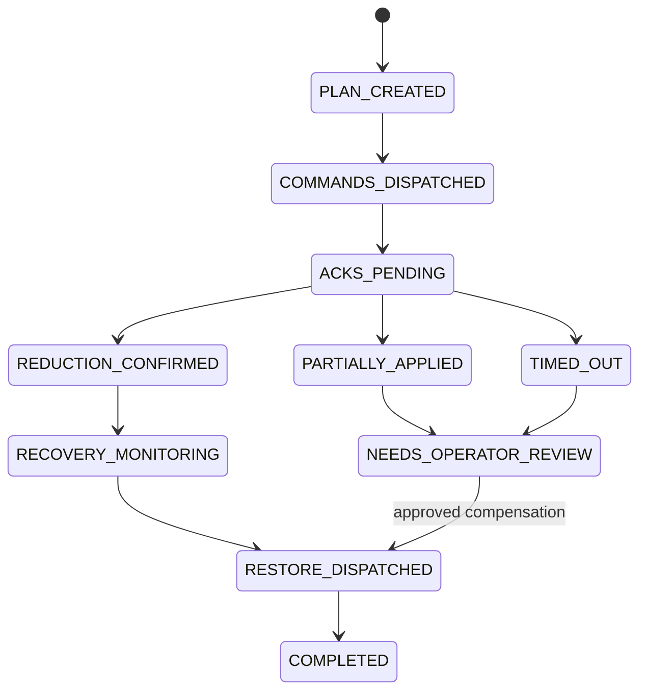

# Distributed Transactions and Control Saga

## Problem

Saving an action plan and publishing commands are separate operations. A crash between them can lose publication or repeat it. A Kafka offset commit also cannot make a simulated charger effect atomic with local database state.

## Transactional outbox and inbox

The Action Service writes the action transition, command records, and outbox rows in one local PostgreSQL transaction. Kafka Connect with Debezium's Outbox Event Router captures committed rows and publishes them to Kafka. The application owns the stable event ID, aggregate/routing key, event type, and payload; Debezium owns change capture and routing rather than a team-written polling relay.

Change-data capture is not treated as end-to-end exactly once. A connector restart can still expose duplicate delivery at a consumer boundary, so re-publication is expected and safe.

Each state-changing consumer uses an inbox keyed by consumer identity and event ID. The inbox entry and business update commit together. Read-only replay consumers cannot invoke external effects. Connector offsets and status are observable, but they do not replace domain-level idempotency.

## Control saga

The saga is orchestration-based: one durable owner decides transitions. Compensation is an explicit restore or operator escalation, not deletion of audit history.

## Invariants

- One active control saga per transformer and policy epoch.
- One logical command per action/device/type combination.
- No command from a stale leader epoch is valid.
- A timeout is an unknown outcome until command status is reconciled.
- Restore requires authoritative state; missing telemetry alone cannot imply recovery.

## Acceptance failures

Restart after plan commit but before publish; publish then crash before Connect persists its source offset; redeliver the load event; apply a device command but lose the response; restart during partial acknowledgement; and replay all topics through a fresh audit group. Every experiment must preserve the invariants and reconstruct an explainable outcome.

## Standalone implementation boundary

[Member_3](../../member3/README.md) implements the PostgreSQL transaction and
saga in [ADR-028](../decisions/ADR-028-member3-action-domain.md). Dispatch states
mean outbox commitment, not a claim of broker delivery. COMMANDS_DISPATCHED and
ACKS_PENDING can commit together while retaining both transition events.
Insufficient flexible capacity goes directly from PLAN_CREATED to
NEEDS_OPERATOR_REVIEW without commands. Intermediate acknowledgements emit
versioned same-state progress; failed restores also enter review. Safe hold is
an operational transformer health state, represented by review or recovery
monitoring on the frozen ActionStatus wire enum. Partial/time-out late results
remain in review; approved operator compensation remains a future API milestone.

Registry v1 supplies capabilities, not online/session/current-rate telemetry.
Fixture snapshots provide those observations explicitly; a future live adapter
must supply equally fresh evidence. Restore needs two distinct consecutive
post-confirmation COMPLETE windows, verified current rates/capabilities and
projected restored load below critical. Missing/stale state cannot satisfy any
of those conditions. Automatic restore never releases a reviewed unknown outcome.

## Completed delivery and fencing boundary

[ADR-029](../decisions/ADR-029-outbox-and-fencing.md) implements the previously
separate CDC/Lease gate. There is no application outbox published flag: Connect
source offsets can lag publication, so repeats are safe by payload event/command
identity. Physical retry row IDs remain distinct. The Lease CAS, durable SQL epoch,
domain outbox transaction, Connect publication/offset, and simulated device effect
are separate boundaries except for typed SQL authorization + simulated effect,
which deliberately share one PostgreSQL transaction under isolated roles/schemas.
A gateway/database crash rolls back uncommitted effects; a lost result replays
without repeating an effect. Epoch advancement serializes against effect commits.
The [runbook](../../infra/member3/README.md) documents exact commands and limits.
