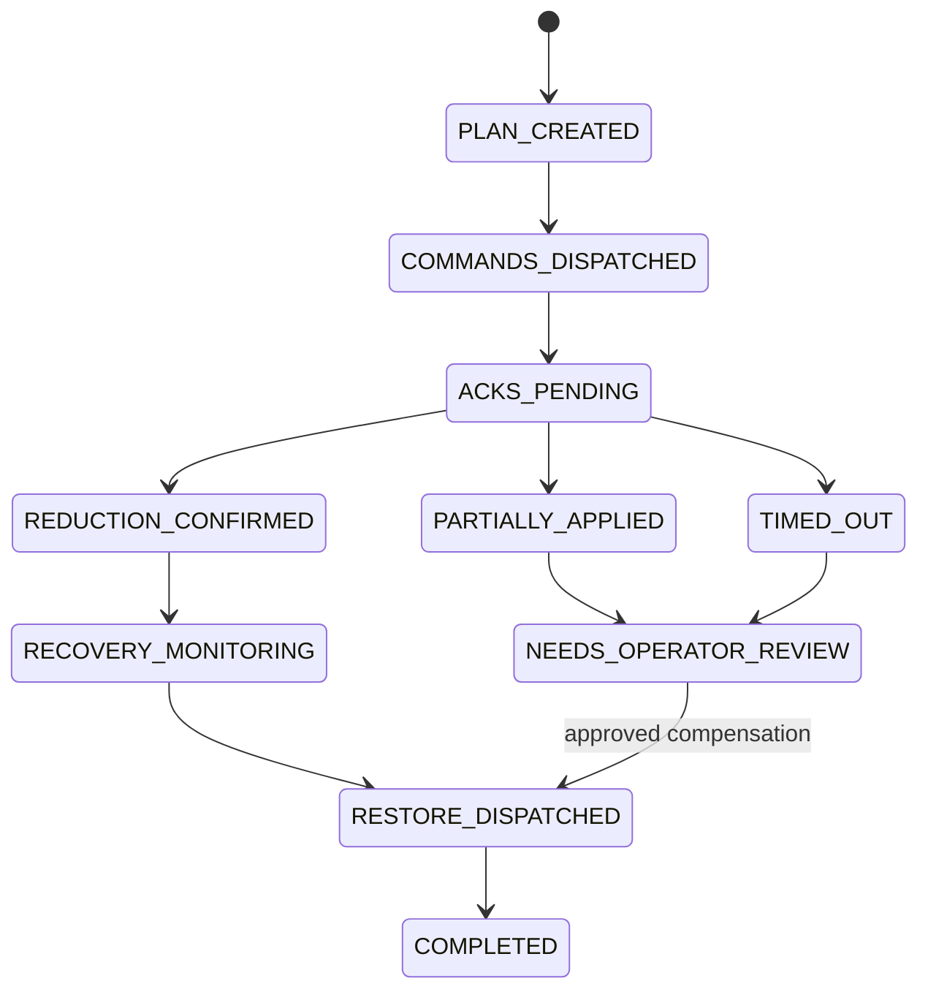

# Distributed Transactions and Control Saga

## Problem

Saving an action plan and publishing commands are separate operations. A crash between them can lose publication or repeat it. A Kafka offset commit also cannot make a simulated charger effect atomic with local database state.

## Transactional outbox and inbox

The Action Service writes the action transition, command records, and outbox rows in one local PostgreSQL transaction. Kafka Connect with Debezium's Outbox Event Router captures committed rows and publishes them to Kafka. The application owns the stable event ID, aggregate/routing key, event type, and payload; Debezium owns change capture and routing rather than a team-written polling relay.

Change-data capture is not treated as end-to-end exactly once. A connector restart can still expose duplicate delivery at a consumer boundary, so re-publication is expected and safe.

Each state-changing consumer uses an inbox keyed by consumer identity and event ID. The inbox entry and business update commit together. Read-only replay consumers cannot invoke external effects. Connector offsets and status are observable, but they do not replace domain-level idempotency.

## Control saga

The saga is orchestration-based: one durable owner decides transitions. Compensation is an explicit restore or operator escalation, not deletion of audit history.

## Invariants

- One active control saga per transformer and policy epoch.
- One logical command per action/device/type combination.
- No command from a stale leader epoch is valid.
- A timeout is an unknown outcome until command status is reconciled.
- Restore requires authoritative state; missing telemetry alone cannot imply recovery.

## Acceptance failures

Restart after plan commit but before publish; publish then crash before marking the outbox; redeliver the load event; apply a device command but lose the response; restart during partial acknowledgement; and replay all topics through a fresh audit group. Every experiment must preserve the invariants and reconstruct an explainable outcome.
