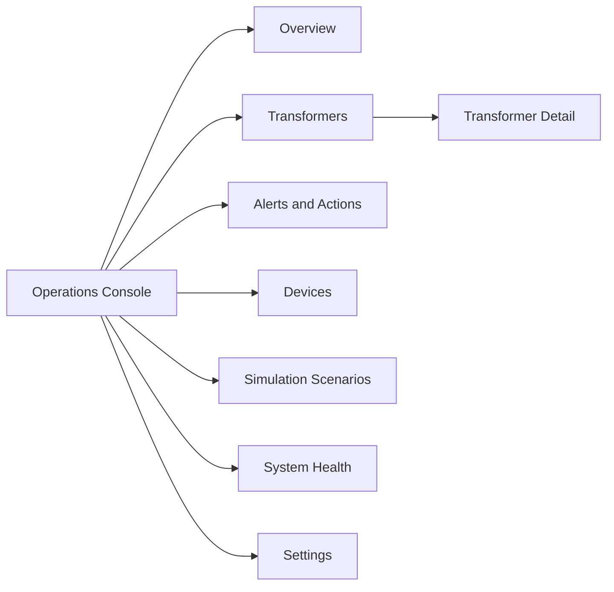

# Operator UI/UX Design

## 1. Product direction

The main UI should feel like a modern operations console: calm, readable, and responsive rather than visually crowded. It must answer three questions quickly:

1. Is the grid healthy right now?
2. Which transformer needs attention and why?
3. What action did the platform take, and did it work?

The planned stack is React, TypeScript, Material UI, and Recharts. REST provides initial snapshots and historical queries; Server-Sent Events provide live updates. Grafana remains a separate engineering tool.

## 2. Information architecture



## 3. Global layout

```text
┌──────────────────────────────────────────────────────────────────────┐
│ GridBalance                    LIVE • Updated 2s ago       Operator ▾ │
├──────────────┬───────────────────────────────────────────────────────┤
│ Overview     │ Page title                         Time range ▾       │
│ Transformers│ ┌────────┐ ┌────────┐ ┌────────┐ ┌────────┐          │
│ Alerts      │ │ KPIs   │ │ KPIs   │ │ KPIs   │ │ KPIs   │          │
│ Devices     │ └────────┘ └────────┘ └────────┘ └────────┘          │
│ Scenarios   │                                                       │
│ Health      │ Primary chart / grid / table                          │
│ Settings    │                                                       │
│             │ Recent alerts and actions                             │
└──────────────┴───────────────────────────────────────────────────────┘
```

On small screens, the sidebar becomes a drawer and KPI cards wrap into one column. Tables retain important columns and move secondary information into expandable rows.

## 4. Screens

### Overview

- KPI cards: total demand, solar contribution, critical transformers, active throttles.
- Live net-load chart across the selected time range.
- Transformer cards sorted by severity and utilization.
- Recent alerts and actions with direct links to details.
- Visible live/stale/reconnecting status.

### Transformer detail

- Capacity, current load, utilization, state, and data freshness.
- Load chart with warning, critical, and recovery lines.
- Breakdown of building, EV, and solar power.
- Active action plan with target reduction and acknowledged result.
- Controllable charger table and chronological event timeline.

### Alerts and actions

- Filterable list by severity, transformer, status, and time.
- Explanation drawer containing the triggering window, policy version, candidates, commands, and outcomes.
- Acknowledge action for operators; acknowledgement does not alter system history.

### Devices

- Searchable table with type, transformer, current power, connectivity, controllability, priority, and last-seen time.
- Device detail panel with recent telemetry and command history.

### Scenarios

- Approved cards for normal load, evening EV spike, solar drop, late telemetry, duplicate delivery, and device outage.
- Controls for scale, transformer count, duration, and deterministic seed.
- Start/stop confirmation and visible run progress. Starting scenarios requires Operator permission.

### System health

- Kafka, Flink, database, action service, API, simulator, and live-stream health.
- Consumer lag, checkpoint age, DLQ rate, API error rate, and stale-transformer count.
- Link to Grafana for deeper engineering investigation.

### Grid Incident Investigator

- Open as a right-side drawer from a transformer, alert, action, or System Health screen so the entity and time window are pre-scoped.
- Accept a focused natural-language question rather than acting as a general-purpose chatbot.
- Stream visible investigation stages such as “checking load history” and “reviewing command results” without exposing hidden model reasoning.
- Present the final response as Summary, Observations, Hypotheses, Unknowns, Recommended Next Steps, and Evidence.
- Make evidence IDs clickable to the corresponding transformer window, action, command, metric interval, or trace summary.
- Show freshness, provider/mock mode, completion state, and an “AI-generated—verify evidence” label.
- Provide clear partial, timed-out, rate-limited, provider-unavailable, and cancelled states.

```text
┌──────────────────────────────────────────────────────────┐
│ Investigate TX-07                              Close  ×  │
├──────────────────────────────────────────────────────────┤
│ Why is this transformer still critical?                  │
│                                              Investigate │
├──────────────────────────────────────────────────────────┤
│ COMPLETED • Evidence observed 18:32:40 • AI-generated    │
│                                                          │
│ Summary                                                  │
│ Four of six throttle commands succeeded. The remaining   │
│ load is consistent with two timed-out chargers.          │
│                                                          │
│ Observations                                             │
│ • Utilization remains 89% [load-window-184]              │
│ • Commands C-05 and C-06 timed out [action-A12]          │
│                                                          │
│ Unknowns                                                 │
│ • No fresh telemetry from chargers EV-21 and EV-34       │
│                                                          │
│ Evidence (4)                                      View ▾ │
└──────────────────────────────────────────────────────────┘
```

## 5. Visual language

- Neutral light background, white surfaces, dark navy text, and restrained blue interaction color.
- `NORMAL`: green, `WARNING`: amber, `CRITICAL`: red, `RECOVERING`: blue, `STALE`: gray.
- Never use color alone; pair status with text and an icon.
- Use consistent kW/MW formatting, UTC-aware local display, and explicit timestamps.
- Keep charts readable with threshold annotations and tooltips, not decorative animation.
- Use subtle transitions for new data while respecting reduced-motion preferences.

## 6. Dynamic behavior

1. Load a REST snapshot when entering a screen.
2. Connect to SSE with a last-event cursor.
3. Merge versioned updates without duplicating records.
4. Show “reconnecting” after missed heartbeats.
5. Mark values stale rather than freezing them without explanation.
6. Refresh the authoritative snapshot after reconnection or cursor gaps.
7. Pause chart animation when the browser tab is hidden while continuing bounded state updates.
8. Create investigations with the current entity/time scope and stream tool-progress events from the Copilot Service.
9. Never merge agent text into authoritative transformer, alert, action, or health state.

## 7. UI states and accessibility

Every screen requires loading, empty, partial-data, stale, permission-denied, and error states. Keyboard navigation, visible focus, semantic headings, labeled controls, contrast-compliant colors, and screen-reader status announcements are acceptance requirements. Critical updates should use a polite live region and must not steal focus.

## 8. UI acceptance criteria

- An operator identifies a critical transformer and current response in under 10 seconds.
- Live values update without a full-page refresh.
- A disconnected stream is obvious and recovers without losing the navigation context.
- The overload-to-recovery story is understandable from the timeline.
- The layout works at desktop and tablet widths.
- Primary workflows are usable with a keyboard and do not rely on color alone.
- An operator can trace each factual agent observation to displayed evidence and distinguish observations from hypotheses.
- Provider failure leaves all non-agent screens and control workflows fully functional.
