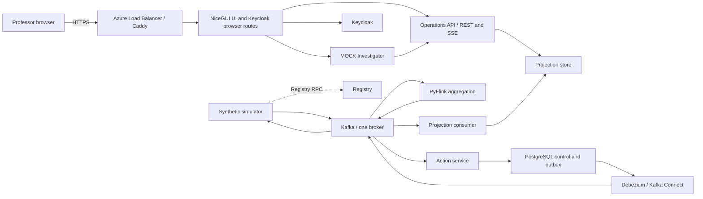

# AKS topology, deployment and verification runbook

Use this runbook from the repository root. It covers maintaining the existing
professor deployment and reproducing the topology in a separately authorized
environment. Read [AGENTS.md](../../AGENTS.md) and
[implementation status](../../docs/implementation/IMPLEMENTATION_STATUS.md)
before changing code. The local kind workflow remains the baseline.

## 1. Identify the target and verify scope

The professor demo uses Azure for Students, resource group
`rg-smart-grid-professor-review`, cluster `smart-grid-aks-review`, and Basic ACR
`smartgridevreview9e9`. AKS is in Denmark East and ACR is in Canada Central.
The public entry point is
[GridBalance](https://smart-grid-ev-review-9e9.denmarkeast.cloudapp.azure.com).
The recorded review end is **December 1, 2026 at 12:32:55 PM PST**. Consult
`.tools/aks-review/handoff.json` and confirm the current deployment before using
these identifiers. Publishing a revision does not extend the review.

Run the shell examples in Bash. Always pass the dedicated kubeconfig and
context. Keep local az/kubectl access scoped to the approved workstation.
Use private, ignored files under `.tools/aks-review/` for evidence and credentials.
The folder is workstation-local and does not come with a repository checkout.
If it is missing, obtain access and retained artifacts from the owner. Confirm
that the checkout includes the hosted overlay and AKS helper described below.

```bash
export REVIEW_GROUP=rg-smart-grid-professor-review
export REVIEW_CLUSTER=smart-grid-aks-review
export REVIEW_ACR=smartgridevreview9e9
export REVIEW_REGISTRY="${REVIEW_ACR}.azurecr.io"
export REVIEW_HOST=smart-grid-ev-review-9e9.denmarkeast.cloudapp.azure.com
export REVIEW_DIR=.tools/aks-review
k() {
  .venv/bin/kubectl --kubeconfig "$REVIEW_DIR/kubeconfig" \
    --context "$REVIEW_CLUSTER" -n platform "$@"
}
az account show --query '{name:name,id:id,state:state}' -o json
review_subscription=$(az account show --query id -o tsv)
az rest --method get --url "https://management.azure.com/subscriptions/${review_subscription}?api-version=2022-12-01" \
  --query '{name:displayName,spendingLimit:subscriptionPolicies.spendingLimit}' -o json
az aks show -g "$REVIEW_GROUP" -n "$REVIEW_CLUSTER" \
  --query '{location:location,sku:sku,pool:agentPoolProfiles[].{count:count,vm:vmSize},state:provisioningState}' -o json
k get nodes -L kubernetes.io/arch
curl -fsS --max-time 15 "https://$REVIEW_HOST/readyz"
```

Confirm the expected subscription and **spending limit On**. If otherwise
valid Kubernetes credentials time out, check the current authorized IP ranges
with `az aks show --query apiServerAccessProfile.authorizedIpRanges` and the
resource group and cluster options above. If the workstation address changed,
coordinate an approved narrow range update with the owner. The accepted
estimate was approximately **$74.20** for setup, 168 hours of review and teardown,
including prior VM usage. The exact Denmark East DS3_v2 price was unavailable.
Check the [Azure Education credit dashboard](https://portal.azure.com/#view/Microsoft_Azure_Education/EducationMenuBlade/~/overview)
and current scope. The spending limit applies to student credits, while $75 is
the project estimate ceiling. The latter is not an Azure-enforced cap. Get owner
approval for new resources, a changed review window, an over-ceiling estimate,
or teardown. A targeted image update uses the existing registry and worker.

## 2. Understand the topology



- AKS Base/Free, Kubernetes 1.34.12 at provisioning, one Linux AMD64
  `Standard_DS3_v2` VMSS system worker, 64 GiB managed OS disk, 60 max pods.
  Azure CNI Overlay with Cilium, standard load balancer and restricted API IP
  ranges. Autoscaling, automatic upgrades and SSH were disabled for the review.
- `platform` holds workloads, PostgreSQL, Kafka/Connect, Flink and the HTTPS
  edge. `grid-operators` holds Strimzi and Flink Kubernetes Operator.
  `observability` holds the pinned monitoring stack.
- The static Standard IP `review-ingress` lives in the AKS-managed node resource
  group. Caddy terminates HTTPS and retains certificate state on disk. Only
  the edge has a public service. Kafka, PostgreSQL, Flink, API, monitoring
  and Keycloak administration are private.
- The `grid-ssd` CSI StorageClass uses Standard SSD and Retain. Platform
  claims hold PostgreSQL, Kafka, Flink checkpoints, Investigator SQLite audit
  and Caddy TLS. Kafka keeps a rolling three hours (size capped, 8 GiB volume); Investigator evidence has nine-day retention.
- Kustomize inheritance is
  [AKS](kustomization.yaml) → [hosted](../hosted/kustomization.yaml) →
  [kind dev](../kind/dev/kustomization.yaml) → [kind base](../kind/base/kustomization.yaml).
  Hosted identity and retention changes belong in `infra/hosted`. Azure
  storage, ingress and Cilium changes belong in `infra/aks`. Shared workload
  changes belong in the base or appropriate overlay.

### Continuous demo, current state (2026-11-26)

The cluster is already at the regional limit of 6 vCPUs (`Standard_DS3_v2` system node plus a `Standard_D2_v2` node labelled
`grid-role=flink`), so no node can be added. Two-subtask Flink runs on the Flink node only; its JobManager must stay there too because the
checkpoint disk is ReadWriteOnce.

| Piece | Where | Notes |
|---|---|---|
| Fleet | `Deployment/fleet`, [fleet.yaml](fleet.yaml) | 25 transformers x 40 devices, 200 events/s, five managed transformers. Control port 8003 (token in Secret `fleet-control`). |
| Control room | `https://<host>/` and `/live`, `/operator` for the console | `DASHBOARD_HOME=live` makes `/` the control room. |
| Grafana | `https://<host>/grafana/` | Anonymous Viewer, five dashboards from `observability/demo_dashboards.py`, route in [edge.yaml](edge.yaml). |
| Action scope | `CONTROL_TRANSFORMERS`, `ACTION_AUTO_COMPENSATE` | Held plans are retried with approved compensation. |
| Projection scope | `PROJECTION_SCOPE=context` | Managed inventory only. Add transformers with `tools.fleet_context` and `projection.live_context` (about 24 chargers per Registry call). |

Build and roll out a code change with source-only layers over the published digests (no emulated dependency build):

```bash
infra/aks/build-layer.sh <fleet|aggregation|action|ui|api|registry> <tag>      # builds, pushes, records the digest
.venv/bin/python -m tools.aks_demo render Deployment/ui                # inspect what will be applied
.venv/bin/python -m tools.aks_demo apply Deployment/ui                 # scoped apply by digest
.venv/bin/python -m tools.demo_check                                   # read-only checklist, exit 1 on a failure
```

To change the fleet size, regenerate the fixture the aggregation image carries and set the fleet environment to match:
`.venv/bin/python -m devices.fleet topology 40 40 5 > devices/fixtures/fleet-topology.json` (the fleet test fails if the committed file differs from the generator),
rebuild the `aggregation` layer, set `FLEET_TRANSFORMERS`, `FLEET_DEVICES`, `FLEET_HEROES` on `Deployment/fleet`, add the new transformer IDs to
`GRID_TRANSFORMERS` (`telemetry-runtime` and the Flink pod environment) and publish context for new managed transformers with `tools.fleet_context`.
Flink handled about 1,100 records/s on its node, so keep devices x (1 / 5 s) under about 700 events/s.

Keep the previous digest (`.tools/aks-demo/ui-previous-image.txt` and the other `*-previous-image` notes) and roll back with `kubectl set image`.
Do not restart Action, PostgreSQL or Kafka during the demonstration: the closed loop recovers by itself, but a held plan takes about a minute to retry.
A Flink spec change restarts the job statelessly; open windows are re-emitted and Action keeps the first copy.

Rules learned from restarts on this cluster:

- Resume a suspended Flink job only after `status.lifecycleState` is `SUSPENDED`. Set `spec.job.state` to `suspended`, wait, then set `running`. Resuming early left the JobManager without its `flink-config-aggregation` ConfigMap.
- Bring `fleet` (the gateway) up before Action. Action retries held plans with compensation at most three times. If it restarts while the gateway is down the retries run out and the plan waits in `NEEDS_OPERATOR_REVIEW`. Close such a plan by setting `status` to `COMPLETED`, `active=false` and `version+1` in both the `version` column and `state->>'version'`, then set the chargers back to 7.2 kW. Never reset `compensations` to 0.
- Renaming a Kafka consumer group is a migration. Stop the consumers, copy the committed offsets with `kafka-consumer-groups.sh --reset-offsets --from-file`, then start the new code. Renaming a PostgreSQL table or role needs the same stop, rename and restart order.
- Flink starts `group-offsets` at the end of the topic for a group that has no committed offsets.

## 3. Initial provisioning in an authorized environment

Skip this section for an existing review. This is a new deployment procedure,
not an upgrade on a seeded cluster.

1. Verify tenant, subscription, credit, spending limit, permissions, Azure
   Policy, regional and VM-family vCPU quota, cluster quota, public IP quota,
   SKU/architecture and regional pricing. Include setup, seven full days
   and teardown in the estimate. Use the exact one-worker configuration for
   provider-side validation. The executed validation and historical SKU price
   checks are recorded in [implementation status](../../docs/implementation/IMPLEMENTATION_STATUS.md).
2. Create the approved dedicated group and Basic ACR with the admin account
   disabled. The original ARM configuration is retained privately at
   `.tools/aks-review/provision.json`. If rebuilding the template, use the
   pool and networking settings above, system-assigned identity, RBAC,
   Standard LB with one managed outbound IP, Azure Disk/File CSI, and the
   approved workstation CIDR. Revalidate the current Kubernetes version and
   SKU in the chosen region. Review the template before sending it to Azure.
3. Deploy the validated ARM template. Give the kubelet pull access to ACR
   using `az aks update --attach-acr`. In the managed node group, reserve the
   static Standard IPv4 `review-ingress` with the approved DNS label. The
   [edge manifest](edge.yaml) binds the load balancer to that IP name. Use
   the resulting FQDN for TLS and OIDC origins.
4. Export a dedicated kubeconfig, verify one Ready AMD64 node, then build and
   publish all eight images. Bootstrap secrets are generated in the ignored
   directory. For an existing PostgreSQL store the bootstrap requires its
   original private credentials.
5. The install helper creates the endpoint ConfigMap, installs operators and
   monitoring, and applies baseline policy. The deploy helper creates
   identity/runtime secrets, installs
   PostgreSQL and bootstraps owned databases, then brings up Kafka, topics,
   Connect/CDC, Flink, Registry, Action, projection, API, Keycloak,
   Investigator, UI and edge in dependency order.
6. Run full fresh-cluster verification. This seeds the one-shot scenario and
   deliberately replaces/restarts workloads for recovery checks. Preserve
   the report, evidence, action ID, private backups and handoff, then start
   the 168-hour review clock at verified handoff.

```bash
umask 077
# Set review_region, review_group_region, review_acr_region, and review_dns_label
# to the approved settings. Use the authorized dedicated names.
az group create -n "$REVIEW_GROUP" -l "$review_group_region"
az acr create -g "$REVIEW_GROUP" -n "$REVIEW_ACR" -l "$review_acr_region" \
  --sku Basic --admin-enabled false
# Run after approving the names, template, cost, and creation scope.
az deployment group validate -g "$REVIEW_GROUP" --validation-level Provider \
  --template-file "$REVIEW_DIR/provision.json"
az deployment group create -g "$REVIEW_GROUP" -n aks-professor-review \
  --template-file "$REVIEW_DIR/provision.json"
az aks update -g "$REVIEW_GROUP" -n "$REVIEW_CLUSTER" --attach-acr "$REVIEW_ACR"
review_node_group=$(az aks show -g "$REVIEW_GROUP" -n "$REVIEW_CLUSTER" --query nodeResourceGroup -o tsv)
az network public-ip create -g "$review_node_group" -l "$review_region" \
  -n review-ingress --sku Standard --allocation-method Static --version IPv4 \
  --dns-name "$review_dns_label"
export REVIEW_HOST=$(az network public-ip show -g "$review_node_group" -n review-ingress \
  --query dnsSettings.fqdn -o tsv)
az aks get-credentials -g "$REVIEW_GROUP" -n "$REVIEW_CLUSTER" \
  --file "$REVIEW_DIR/kubeconfig" --context "$REVIEW_CLUSTER"
chmod 600 "$REVIEW_DIR/kubeconfig"
make delivery-render
DOCKER_DEFAULT_PLATFORM=linux/amd64 .venv/bin/python -m tools.delivery_images \
  --repository smart-grid-aks-review --inventory "$REVIEW_DIR/images.json"
.venv/bin/python -m tools.aks_review publish --registry "$REVIEW_REGISTRY"
for stage in install deploy verify; do
  .venv/bin/python -m tools.aks_review "$stage" --registry "$REVIEW_REGISTRY" \
    --host "$REVIEW_HOST" || break
done
```

## 4. Update an existing review after a code change

1. Inspect `git status --short`, the diff, and original handoff. Preserve
   unrelated changes. Run focused local tests before publishing. Use
   `make dashboard-test` for UI, `make aggregation-test` for aggregation, and the
   relevant component targets elsewhere. Run `make contracts` for a contract
   change and `make delivery-render` for deployment changes.
2. Identify all affected images and resources. Scope the rollout to them.
   Review migrations and checkpoint compatibility separately. Preserve prior
   image digests, approved state backups and volume claims before any stateful
   update. Avoid applying the raw rendered overlay to the live cluster.
   The staging helper substitutes immutable ACR references for local tags.
3. Build on the workstation with `--platform linux/amd64` (or
   `DOCKER_DEFAULT_PLATFORM=linux/amd64`). Verify the architecture. Publish a
   uniquely tagged candidate to the matching ACR repository. Use the push
   result’s manifest digest for the rollout. Keep the previous digest.
4. Run the checks in section 5. After success update private
   `published-images.json` (overlay tag → registry digest) and `images.json`
   (local tag → inspected ID, architecture and original overlay tag) if
   those files will be used by the staging helper. Record the change, running
   digest and executed verification in implementation status.
   Git publication is a separate operation and requires authorization.

| Code or configuration | Build | Runtime update target |
|---|---|---|
| `dashboard/` | `infra/kind/Dockerfile --target ui` | `deployment/ui`, container `ui` |
| `projection/` | `infra/kind/Dockerfile --target api` | `deployment/api` and `deployment/projection` |
| `identity/` | Affected consumers of the package in `infra/kind/Dockerfile` | Review UI, API/projection and Copilot together |
| `action/` | `infra/kind/Dockerfile --target action` and acceptance if bootstrap or simulator dependencies changed | Action Deployment and future Jobs as applicable |
| `devices/` | `devices/Dockerfile --target registry` and acceptance if simulator changed | Registry Deployment and future simulator Job |
| `copilot/` | `infra/kind/Dockerfile --target copilot` | `deployment/copilot` |
| `aggregation/` | `aggregation/Dockerfile` | `FlinkDeployment/aggregation` via its operator |
| Connect image | `infra/connect/Dockerfile.connect --target strimzi` | `KafkaConnect/grid-connect` via Strimzi |
| Bootstrap or smoke inputs | `infra/kind/Dockerfile --target acceptance` | Future bootstrap/simulator Jobs with explicit approval when state is involved |

For a UI-only change, use this pattern. The other Deployments use their
corresponding container names from `k get deployment ...`. Operator-managed
workloads must be changed through their custom resource plus a state/recovery
plan, rather than by editing generated Pods or Deployments.

```bash
set -e -o pipefail
umask 077
make dashboard-test
rev="ui-$(date -u +%Y%m%d%H%M%S)"
candidate="$REVIEW_REGISTRY/smart-grid-kind/ui:$rev"
docker build --platform linux/amd64 --provenance=false \
  -f infra/kind/Dockerfile --target ui -t "$candidate" .
test "$(docker image inspect "$candidate" --format '{{.Os}}/{{.Architecture}}')" = linux/amd64
az acr login -n "$REVIEW_ACR"
docker push "$candidate" 2>&1 | tee "$REVIEW_DIR/$rev-push.log"
digest=$(sed -nE 's/.*digest: (sha256:[a-f0-9]{64}).*/\1/p' "$REVIEW_DIR/$rev-push.log" | tail -n 1)
test -n "$digest"
k get deployment ui -o jsonpath='{.spec.template.spec.containers[?(@.name=="ui")].image}' \
  > "$REVIEW_DIR/$rev-previous-image"
k set image deployment/ui "ui=$REVIEW_REGISTRY/smart-grid-kind/ui@$digest"
k rollout status deployment/ui --timeout=240s
k get pods -l grid-app=ui \
  -o 'custom-columns=NAME:.metadata.name,READY:.status.containerStatuses[0].ready,IMAGE:.status.containerStatuses[0].imageID'
```

Check the digest on the **Ready replacement pod**. A terminating old pod can
still appear in a list after rollout completes. If Docker upload is flaky,
retry the push by layer reuse. The original large Flink image needed an
Azure-side import of its pinned public base plus chunked upload in the
ignored workstation tooling. Leave the running image unchanged until the
new digest has been verified in ACR.

## 5. Post-deploy checks and rollback

### Hosted entry points

The site opens without a login (mock-auth mode, `AUTH_MODE=mock`). `/` and `/live` show the live control room, `/operator` shows the full console, and `/grafana/` serves the read-only dashboards. The UI and API read a Viewer-level mock identity from the Secret `mock-identity-runtime` (keys `DASHBOARD_API_TOKEN` and `MOCK_IDENTITIES`). Keycloak and the Investigator run at zero replicas on this cluster. Public API and administration routes stay blocked at the edge, and Prometheus stays private. Do not reset or import over the existing realm.

Action once exited on a transient three-second Lease GET timeout. It now retries only transient Lease reads, up to three attempts. Uncertain writes still fail immediately, and the monotonic deadlines and PostgreSQL fencing still deny expired leadership. Check the restart count of the replacement pod over an observed interval.

```bash
curl -fsS --max-time 15 "https://$REVIEW_HOST/healthz"
curl -fsS --max-time 15 "https://$REVIEW_HOST/readyz"
k get deploy,sts,pvc,svc,flinkdeployment,kafka,kafkaconnect
k exec grid-connect-connect-0 -- curl -fsS --max-time 5 \
  http://127.0.0.1:8083/connectors/integration-kind/status
```

- Verify Ready workload replicas, bound volumes, Flink **RUNNING/STABLE**,
  and Debezium connector **and task** both **RUNNING**. A ready Connect pod
  alone says nothing about its task. Review targeted events/logs for any
  unhealthy component. In a known recoverable task failure, inspect the cause,
  restart only the task with
  `k annotate kafkaconnector integration-kind strimzi.io/restart-task=0 --overwrite`,
  then recheck REST status. The previously verified recovery used the
  existing replication slot after a PostgreSQL connectivity timeout.
- In a fresh browser open `/` and `/live` (KPI strip, heat map, action feed), `/operator` (Flow Map, Alerts & actions) and `/grafana/d/grid-control-room`. Trigger an overload on `tx-003` from the fault panel and watch the action go from plan to restore. `tools.demo_check` covers the same ground without a browser.
- If a targeted rollout fails, capture the failure and restore the exact
  previous digest, then rerun readiness and the hosted smoke path. For UI use
  `k set image deployment/ui "ui=$(cat "$REVIEW_DIR/$rev-previous-image")"`
  followed by `k rollout status deployment/ui --timeout=240s`.
  For changes with schema or state effects, use the approved rollback plan
  before reverting the binary. Do not reset volumes to recover a rollout.
- Record test commands/results, both image digests, any incidents and remaining
  limitations. Avoid replaying the seeded simulator or running the full
  `tools.aks_review verify` / `recover` on an active review without explicit
  approval for those disruptions. Ask before deleting Azure resources.

The primary implementation references are
[tools/aks_review.py](../../tools/aks_review.py),
[tools/kind_local.py](../../tools/kind_local.py),
[tools/delivery_images.py](../../tools/delivery_images.py),
[the master guide](../../docs/MASTER_GUIDE.md), and
[implementation status](../../docs/implementation/IMPLEMENTATION_STATUS.md).
